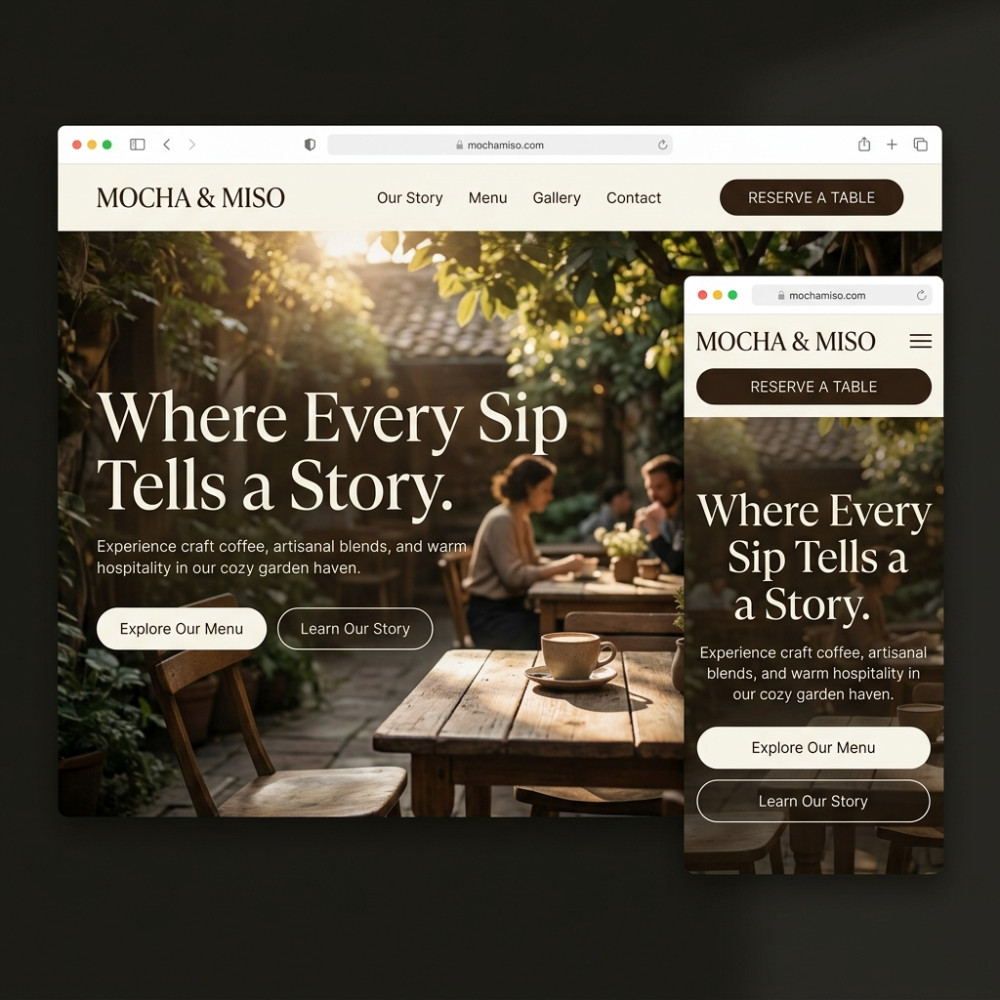

# Mocha & Miso — Hệ thống quản lý quán cà phê

Website giới thiệu thương hiệu và bộ công cụ vận hành quán cà phê: đặt bàn, gọi món QR, quản lý đơn và doanh thu, kho, cùng hồ sơ nhân sự.



## Tính năng

| Phân hệ | Chức năng chính | Trang |
|---|---|---|
| Website khách hàng | Giới thiệu, xem thực đơn, gửi yêu cầu đặt bàn | [`index.html`](./index.html) |
| Quản trị | Đăng nhập Firebase, duyệt đặt bàn/đơn Firestore, cập nhật thanh toán, xem doanh thu | [`admin.html`](./admin.html) |
| Gọi món QR | Chọn món theo bàn, thêm ghi chú, gửi đơn | [`order.html`](./order.html?table=01) |
| Quản lý kho | Theo dõi nguyên liệu, tồn thấp, phiếu nhập và xuất | [`inventory.html`](./inventory.html) |
| Nhân sự | Hồ sơ nhân viên, ca, chấm công và bảng lương | [`hr.html`](./hr.html) |
| Mã QR | Tạo mã QR theo số bàn | [`qr.html`](./qr.html) |

## Kiến trúc hiện tại

- **Frontend:** HTML, CSS và JavaScript thuần; Firebase SDK được dùng cho các chức năng đang hoạt động. Supabase client/SQL cũ được giữ lại tạm thời trong giai đoạn di trú kho.
- **Cổng quản trị:** Firebase Authentication xác thực tài khoản quản trị cũ; đặt bàn, đơn và doanh thu trong cổng này đọc/ghi qua Cloud Firestore.
- **Nhân sự:** Firebase Authentication và Cloud Firestore dùng chung project với cổng quản trị; hồ sơ, ca, chấm công và bảng lương nằm trong các collection `employees`, `employee_shifts`, `employee_attendance` và `employee_payroll`.
- **Đặt bàn trên website:** Gửi yêu cầu trực tiếp vào Cloud Firestore bằng cùng Firebase project với cổng quản trị; không cần Supabase.
- **Quản lý kho:** Dùng chung Firebase Authentication và Cloud Firestore với Admin. Dữ liệu nguyên liệu nằm trong `inventory`; lịch sử nhập/xuất nằm trong `stock_imports` và `stock_exports`.
- **Gọi món QR và quản trị đơn:** Trang QR ghi đơn vào Firestore; cổng quản trị cũng đọc/cập nhật đơn từ Firestore để doanh thu nhận đúng đơn đã thanh toán.
- **Thực đơn:** Trang giới thiệu và trang gọi món QR dùng chung giá trong [`js/menu-data.js`](./js/menu-data.js).
- **Dữ liệu cũ:** Các bảng Supabase kho và HR không bị script di trú xóa; việc chuyển kho phải được chạy và đối soát riêng trước khi gỡ client/schema legacy.
- EmailJS là tích hợp tùy chọn phía client. Không đưa service-role key hoặc Firebase service-account vào trình duyệt.

## Chạy local

Yêu cầu: Python 3. Mở PowerShell tại thư mục dự án và chạy:

```powershell
npm.cmd start
```

Sau đó mở:

| Mục đích | Địa chỉ |
|---|---|
| Website khách | <http://localhost:8000/index.html> |
| Quản trị | <http://localhost:8000/admin.html> |
| Gọi món bàn 01 | <http://localhost:8000/order.html?table=01> |
| Quản lý kho | <http://localhost:8000/inventory.html> |
| Nhân sự | <http://localhost:8000/hr.html> |
| Tạo mã QR | <http://localhost:8000/qr.html> |

## Di trú dữ liệu kho Supabase sang Firestore

Trang [`inventory.html`](./inventory.html) dùng Firebase Auth/Firestore. Rules giới hạn đọc và ghi `inventory`, `stock_imports` và `stock_exports` cho tài khoản admin đã cấu hình; triển khai [`firestore.rules`](./firestore.rules) lên project hiện tại bằng `firebase deploy --only firestore:rules --project project-quan-cafe` trước khi sử dụng.

**Trạng thái hiện tại:** giao diện đã chuyển sang Firestore nhưng migration production chưa được chạy ở môi trường này. Hãy sao lưu và tạm dừng nhập/xuất trên phiên bản Supabase cũ trong lúc di trú; không đưa giao diện mới vào vận hành với dữ liệu thật trước khi hoàn tất đối soát.

Các bảng Supabase cũ vẫn được giữ nguyên. Công cụ [`scripts/migrate-supabase-inventory-to-firestore.js`](./scripts/migrate-supabase-inventory-to-firestore.js) sao chép dữ liệu qua Supabase REST API sang cùng Firebase project, không sửa/xóa nguồn và bỏ qua tài liệu đích đã tồn tại. Hãy sao lưu và đối soát trước khi dùng:

1. Dùng tài khoản Supabase admin có quyền đọc ba bảng `inventory`, `stock_imports`, `stock_exports`, và thông tin xác thực Firebase Admin của **project hiện tại**. Không đưa access token, service-account hay secret vào Git hoặc chia sẻ trong chat.
2. Đặt biến môi trường cục bộ `SUPABASE_URL`, `SUPABASE_ANON_KEY`, `SUPABASE_ACCESS_TOKEN` (JWT phiên Supabase admin) và `GOOGLE_APPLICATION_CREDENTIALS` (đường dẫn service-account Firebase). Script cố định project đích theo `.firebaserc` và từ chối giá trị `FIREBASE_PROJECT_ID` khác project đó.
3. Chạy `npm.cmd run migrate:inventory:dry-run` để ước tính số bản ghi mới/bỏ qua; kiểm tra backup, dữ liệu nguồn và project đích.
4. Chạy `npm.cmd run migrate:inventory` để sao chép. Có thể chạy lại an toàn; công cụ không ghi đè tài liệu Firestore cùng ID di trú và không xóa dữ liệu Supabase.
5. Đối chiếu số lượng, mã/tên nguyên liệu, tồn kho, giá, nhà cung cấp và các phiếu nhập/xuất trên Firebase thật. Chỉ sau khi đối soát và kiểm thử quyền truy cập thành công mới gỡ Supabase SDK/client, script và schema legacy.

Nút **⚡ Nạp 46 nguyên liệu mẫu** chỉ thêm nguyên liệu chưa có; không đặt lại/ghi đè số lượng hiện tại. Chức năng kho không dùng Local Storage làm nguồn ghi thay thế khi Firestore lỗi.

## Chuyển dữ liệu Firestore hiện có

Tập lệnh nhập **chỉ** hai collection `reservations` và `orders`. Nó ánh xạ camelCase sang snake_case, lưu document ID gốc trong `source_firebase_id`, upsert theo ID này để có thể chạy lại an toàn, và không xóa hay sửa dữ liệu Firebase. Các tài khoản/mật khẩu Firebase không được chuyển.

1. Sao lưu Firestore và chạy schema Supabase ở trên trước. Sau đó thiết lập thông tin trong PowerShell; đường dẫn service-account phải nằm ngoài repository:

   ```powershell
   npm install
   $env:FIREBASE_PROJECT_ID = "firebase-project-id"
   $env:GOOGLE_APPLICATION_CREDENTIALS = "C:\secure\firebase-service-account.json"
   $env:SUPABASE_URL = "https://your-project.supabase.co"
   $env:SUPABASE_SERVICE_ROLE_KEY = "your-service-role-key"
   $env:MIGRATION_DRY_RUN = "1"
   npm run migrate:firebase
   ```

2. Xem số lượng bản ghi đã kiểm tra và sửa các bản ghi thiếu/không hợp lệ ở nguồn trước khi ghi. Khi đã xác nhận project đích, chạy:

   ```powershell
   $env:MIGRATION_DRY_RUN = "0"
   npm run migrate:firebase
   ```

3. So sánh số bản ghi Firestore với các dòng có `source_firebase_id` trong Supabase, kiểm tra đặt bàn/đơn mẫu, RLS và đăng nhập admin. Chỉ chuyển traffic sau khi xác minh; giữ bản sao Firestore cho tới khi đối soát hoàn tất.

Service-role key và Firebase service-account chỉ dùng trên máy chạy migration; không dán vào chat, không commit, và xóa khỏi biến môi trường sau khi dùng (`Remove-Item Env:SUPABASE_SERVICE_ROLE_KEY`, `Remove-Item Env:GOOGLE_APPLICATION_CREDENTIALS`).

## EmailJS

Email đặt bàn chỉ hoạt động khi Service ID, Template ID và Public Key được cấu hình trong `EMAILJS_CONFIG` tại [`index.html`](./index.html). Đây là public key phía trình duyệt; không đưa private key hoặc thông tin bí mật vào client.

## Chăm sóc khách hàng và lượt ghé

- Hướng dẫn sử dụng hồ sơ khách hàng và ghi nhận lượt ghé: [CUSTOMER_CARE_GUIDE.md](./CUSTOMER_CARE_GUIDE.md)
- Các tình huống kiểm thử và giới hạn tích hợp: [CUSTOMER_CARE_TEST_PLAN.md](./CUSTOMER_CARE_TEST_PLAN.md)
- Quy tắc Firestore cho đặt bàn và lượt ghé nằm trong [firestore.rules](./firestore.rules).

## Kiểm thử

```powershell
node --test tests/*.test.js
```

Các test bao gồm xác thực Firebase, nghiệp vụ khách hàng, gọi món QR, doanh thu, HR và các luồng phân bàn/chăm sóc khách hàng. Chúng dùng mock/offline; không thay thế kiểm thử quyền truy cập trên Firebase/Supabase thật.
