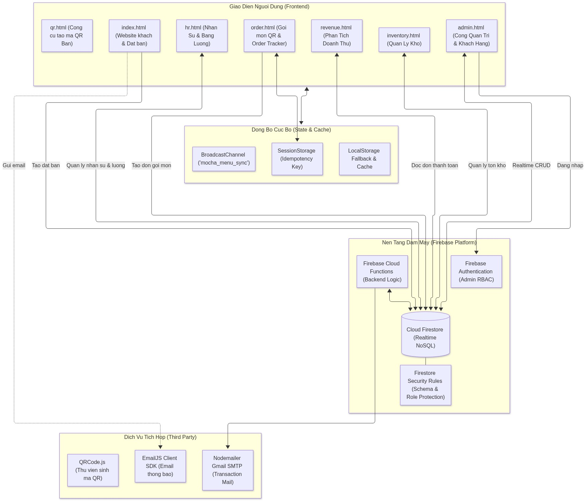
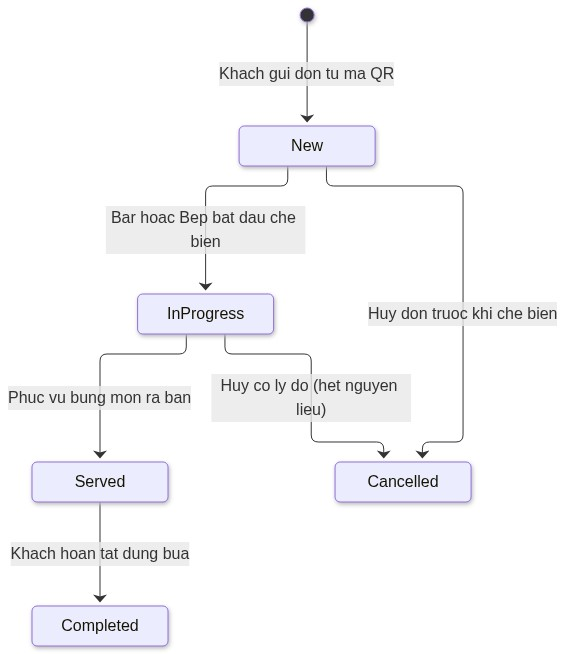
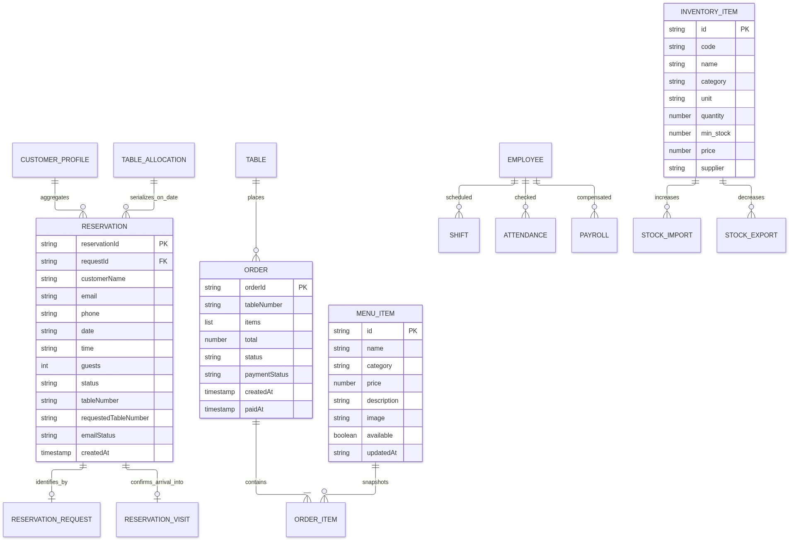
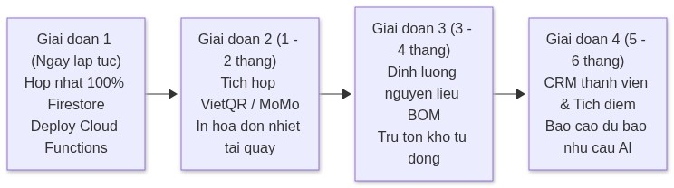

# BÁO CÁO TOÀN DIỆN VỀ DỰ ÁN HỆ THỐNG QUẢN LÝ QUÁN CÀ PHÊ MOCHA & MISO
*(Mocha & Miso — Craft Café Management System)*

---

> **Ngày lập báo cáo:** 22/11/2026  
> **Phiên bản hệ thống:** 2.4 (Hợp nhất Firebase Firestore & Mở rộng Quản lý Thực đơn)  
> **Ngôn ngữ & Nền tảng:** JavaScript ES6+ (Native), HTML5, CSS3, Firebase (Auth, Firestore, Cloud Functions), Supabase/PostgreSQL (Legacy)  
> **Trạng thái:** Hoàn thiện các phân hệ cốt lõi, đã xây dựng bộ kiểm thử tự động, đang trong giai đoạn tối ưu hóa vận hành và tích hợp nâng cao.

---

## MỤC LỤC
1. [TỔNG QUAN DỰ ÁN & GIÁ TRỊ DOANH NGHIỆP](#1-tổng-quan-dự-án--giá-trị-doanh-nghiệp)
2. [KIẾN TRÚC KỸ THUẬT & NGĂN XẾP CÔNG NGHỆ (TECH STACK)](#2-kiến-trúc-kỹ-thuật--ngăn-xếp-công-nghệ-tech-stack)
3. [CHI TIẾT CÁC PHÂN HỆ CHỨC NĂNG (CORE MODULES)](#3-chi-tiết-các-phân-hệ-chức-năng-core-modules)
   - 3.1. Website Khách Hàng & Trải Nghiệm Thương Hiệu
   - 3.2. Đặt Bàn Trực Tuyến & Chống Gửi Lặp (Idempotency)
   - 3.3. Gọi Món Tại Bàn Qua QR Code & Theo Dõi Tiến Độ (Order Tracker)
   - 3.4. Cổng Quản Trị Trung Tâm (Admin Dashboard)
   - 3.5. Báo Cáo & Phân Tích Doanh Thu (Revenue Analytics)
   - 3.6. Quản Lý Thực Đơn Năng Động (Menu Management)
   - 3.7. Quản Lý Kho Nguyên Vật Liệu (Inventory System)
   - 3.8. Quản Lý Nhân Sự, Ca Làm Việc & Bảng Lương (HR & Payroll)
   - 3.9. Công Cụ Tạo Mã QR Bàn (Table QR Generator)
4. [MÔ HÌNH DỮ LIỆU & CHIẾN LƯỢC BẢO MẬT (DATA & SECURITY)](#4-mô-hình-dữ-liệu--chiến-lược-bảo-mật-data--security)
   - 4.1. Sơ đồ thực thể liên kết (ER Diagram)
   - 4.2. Cấu trúc Firestore Collections & PostgreSQL Schema
   - 4.3. Phân quyền và Quy tắc bảo mật Firestore (Security Rules)
5. [ĐÁNH GIÁ KIỂM THỬ & ĐẢM BẢO CHẤT LƯỢNG (TESTING & QA)](#5-đánh-giá-kiểm-thử--đảm-bảo-chất-lượng-testing--qa)
6. [PHÂN TÍCH ĐIỂM MẠNH, ĐIỂM YẾU & RỦI RO (SWOT ANALYSIS)](#6-phân-tích-điểm-mạnh-điểm-yếu--rủi-ro-swot-analysis)
7. [LỘ TRÌNH PHÁT TRIỂN ĐỀ XUẤT (STRATEGIC ROADMAP)](#7-lộ-trình-phát-triển-đề-xuất-strategic-roadmap)
8. [HƯỚNG DẪN CÀI ĐẶT, VẬN HÀNH & TRIỂN KHAI](#8-hướng-dẫn-cài-đặt-vận-hành--triển-khai)

---

## 1. TỔNG QUAN DỰ ÁN & GIÁ TRỊ DOANH NGHIỆP

### 1.1. Bối cảnh và Tầm nhìn
**Mocha & Miso** là giải pháp phần mềm quản trị và vận hành toàn diện cho mô hình quán cà phê đặc sản (Specialty Craft Coffee) kết hợp ẩm thực nhẹ. Dự án định hình theo ngôn ngữ thiết kế **Japandi** (sự giao thoa giữa chủ nghĩa tối giản ấm áp của Nhật Bản và tính công năng thực dụng của Bắc Âu), mang lại trải nghiệm nhẹ nhàng, tinh tế và cao cấp cho cả khách hàng lẫn nhân viên vận hành.

Thông điệp thương hiệu: *"Nơi mỗi ngụm cà phê kể một câu chuyện."*

### 1.2. Mục tiêu kinh doanh
1. **Đối với Khách hàng:** Nâng tầm trải nghiệm số — từ việc tìm hiểu câu chuyện thương hiệu, khám phá thực đơn theo mùa, đặt bàn giữ chỗ trước mà không cần gọi điện thoại, cho đến việc tự gọi món tại bàn thông qua quét mã QR với thời gian phục vụ nhanh nhất.
2. **Đối với Nhân viên (Barista / Bếp / Phục vụ):** Giảm thiểu sai sót khi ghi nhận order, hiển thị trực quan các yêu cầu đặc biệt (ít đường, ít đá, ăn kiêng), cập nhật trạng thái phục vụ thời gian thực.
3. **Đối với Cấp Quản lý & Chủ quán:** Tự động hóa toàn bộ quy trình từ khâu đặt bàn, bán hàng, kiểm soát nguyên vật liệu tồn kho, chấm công tính lương nhân viên, đến tổng hợp báo cáo doanh thu minh bạch, chống thất thoát.

### 1.3. Các bên thụ hưởng (Stakeholders)
```
┌────────────────────────────────────────────────────────────────────────┐
│                        MOCHA & MISO ECOSYSTEM                          │
├──────────────────┬───────────────────┬─────────────────────────────────┤
│ Khách Hàng       │ Nhân Viên Vận Hành│ Nhà Quản Lý & Chủ Quán          │
│ • Xem menu & giá │ • Nhận order bàn  │ • Điều phối đặt bàn & gán chỗ   │
│ • Đặt bàn online │ • Cập nhật chế biến│ • Quản lý menu & giá bán        │
│ • Quét QR gọi món│ • Quản lý ca kíp  │ • Kiểm soát kho & cảnh báo tồn  │
│ • Theo dõi đơn   │ • Chấm công vào/ra│ • Duyệt lương & Doanh thu chuẩn │
└──────────────────┴───────────────────┴─────────────────────────────────┘
```

---

## 2. KIẾN TRÚC KỸ THUẬT & NGĂN XẾP CÔNG NGHỆ (TECH STACK)

### 2.1. Sơ đồ Kiến trúc Tổng thể



### 2.2. Chi tiết Công nghệ Triển khai
- **Frontend Core:** HTML5 ngữ nghĩa, CSS3 hiện đại (CSS Variables, Flexbox, Grid, keyframes animation phong cách tối giản), Vanilla JavaScript ES6+. Thiết kế thuần Native (không dùng Angular/React/Vue) đem lại lợi thế tải trang siêu tốc (<1.2 giây), dung lượng nhẹ, dễ bảo trì và không vướng rủi ro phụ thuộc thư viện bên ngoài.
- **Responsive Web Design:** Tối ưu hóa giao diện di động (Mobile-First) hỗ trợ hoàn hảo từ màn hình điện thoại 360px cho tới máy tính bảng và màn hình máy tính 4K.
- **Cơ sở dữ liệu Realtime (Cloud Firestore):** Tận dụng kiến trúc Document-Collection với tính năng lắng nghe thời gian thực (`onSnapshot`), giúp bàn điều khiển Admin và màn hình gọi món tự động cập nhật ngay khi có biến động mà không cần tải lại trang.
- **Xác thực & Bảo mật (Firebase Auth):** Đăng nhập định danh quản trị viên, kiểm tra domain hợp lệ và bảo vệ phân quyền trên tầng Security Rules.
- **Giao tiếp liên Tab (BroadcastChannel API):** Sử dụng kênh `mocha_menu_sync` cho phép các tab trình duyệt khác nhau cập nhật thay đổi thực đơn ngay lập tức với độ trễ 0ms.
- **Backend Serviceless (Firebase Cloud Functions):** Chạy Node.js môi trường cô lập, đảm bảo việc xác thực giá món, chống gian lận đơn hàng và phân bổ bàn diễn ra ở phía máy chủ đáng tin cậy.

---

## 3. CHI TIẾT CÁC PHÂN HỆ CHỨC NĂNG (CORE MODULES)

### 3.1. Phân hệ 1: Website Khách Hàng & Trải Nghiệm Thương Hiệu
- **Tập tin chính:** `index.html`, `js/main.js`, `css/style.css`
- **Chức năng chính:**
  - Giới thiệu triết lý quán, hành trình cà phê thủ công, nguyên liệu hữu cơ tuyển chọn từ Đà Lạt và các nông trại uy tín.
  - Trưng bày không gian quán thông qua thư viện ảnh nghệ thuật, cung cấp thông tin liên hệ, sơ đồ vị trí và thời gian hoạt động.
  - Trưng bày thực đơn 15 món nổi bật chia làm 4 danh mục: *Cà phê*, *Đồ uống*, *Đồ ăn*, và *Tráng miệng*.
  - Tải dữ liệu thực đơn từ `js/menu-data.js` và đồng bộ tự động với Firestore `menuItems`.

### 3.2. Phân hệ 2: Đặt Bàn Trực Tuyến & Chống Gửi Lặp (Idempotency)
- **Tập tin chính:** `index.html`, `js/main.js`, `firestore.rules`, `functions/services/tableAssignment.js`
- **Quy trình hoạt động:**
  1. Khách hàng nhập thông tin: Họ tên, Email, Số điện thoại, Ngày đặt, Giờ nhận bàn (các slot cố định từ 07:30 đến 20:00), Số lượng khách (1 – 12 người), Ghi chú đặc biệt và Bàn mong muốn (tùy chọn B01 - B20).
  2. Hệ thống kiểm tra hợp lệ phía client: Chặn ngày trong quá khứ theo múi giờ `Asia/Ho_Chi_Minh`, kiểm tra định dạng email và số điện thoại 10 số.
  3. **Cơ chế Idempotency chống gửi lặp (UUIDv4 + SHA-256 Hash):**
     - Sinh mã `requestId` duy nhất lưu vào `sessionStorage`.
     - Tạo Firestore Batch đồng thời ghi tài liệu vào `reservations` (trạng thái `pending`) và `reservationRequests` (chứa fingerprint mã hóa).
     - Nếu mạng lag hoặc khách bấm nút nhiều lần, hệ thống nhận diện request trùng và không sinh thêm bản ghi rác.
  4. Sau khi ghi nhận thành công, gửi email tự động qua EmailJS / Cloud Functions Nodemailer.

### 3.3. Phân hệ 3: Gọi Món Tại Bàn Qua QR Code & Theo Dõi Tiến Độ
- **Tập tin chính:** `order.html`, `js/order.js`, `css/order.css`, `functions/services/orderService.js`
- **Quy trình hoạt động:**
  1. **Nhận diện bàn qua URL:** Khách quét mã QR truy cập đường dẫn định dạng `order.html?table=05`. Hệ thống kiểm tra mã bàn chuẩn từ `01` đến `99`. Nếu thiếu hoặc sai số bàn, hệ thống hiển thị trang cảnh báo an toàn và không cho phép tạo đơn.
  2. **Thao tác chọn món & Giỏ hàng:**
     - Lọc món theo danh mục, tìm kiếm theo tên.
     - Xem hình ảnh, mô tả hương vị và giá bán chuẩn VNĐ.
     - Tăng / giảm số lượng, nhập ghi chú riêng cho từng món (ví dụ: *ít ngọt, không đá, sốt để riêng*).
     - Giỏ hàng cố định ở cạnh dưới màn hình hiển thị tạm tính và số lượng món.
  3. **Gửi đơn hàng an toàn:**
     - Kiểm tra đơn phải có ít nhất 1 món, tổng số lượng không vượt quá 20 món/lần gửi.
     - Tạo tài liệu đơn hàng với `status: 'new'`, `paymentStatus: 'unpaid'`.
     - Tích hợp hàm máy chủ `submitTableOrder` kiểm tra lại toàn bộ giá gốc và tính toán tổng tiền chính xác từ database, loại bỏ nguy cơ can thiệp giá từ phía người dùng.
  4. **Bộ theo dõi tiến trình đơn hàng (Realtime Order Tracker):**
     - Hiển thị thanh tiến trình 4 giai đoạn sống động:
       20g20g**Đã gửi đơn → Đang chuẩn bị → Đã phục vụ → Hoàn tất**20g20g
     - Lắng nghe sự kiện Firestore `onSnapshot`. Khi nhân viên hoặc quầy bar cập nhật trạng thái đơn, giao diện khách lập tức chuyển màu và hiển thị thông báo tương ứng.
     - Lưu trạng thái đơn đang theo dõi vào `localStorage`/`sessionStorage` giúp khách không bị mất tiến trình nếu vô tình tải lại trình duyệt.



### 3.4. Phân hệ 4: Cổng Quản Trị Trung Tâm (Admin Dashboard)
- **Tập tin chính:** `admin.html`, `admin.js`, `CUSTOMER_CARE_GUIDE.md`, `TABLE_ASSIGNMENT_GUIDE.md`
- **Chức năng chính:**
  1. **Bảo mật truy cập:** Đăng nhập qua Firebase Authentication, giới hạn danh sách email quản trị viên được ủy quyền (`isAdmin()`).
  2. **Quản lý Đặt bàn & Điều phối Bàn (Table Assignment):**
     - Xem danh sách đặt bàn theo thời gian thực (Lọc theo: *Tất cả, Chờ xử lý, Đã xác nhận, Đã hủy*).
     - Gán số bàn thực tế (B01 - B20) cho khách dựa trên bàn gợi ý của khách và sơ đồ chỗ ngồi:
       - *B01 – B04:* 2 chỗ ngồi (bàn đơn/cặp đôi)
       - *B05 – B08, B13 – B20:* 4 chỗ ngồi (bàn tiêu chuẩn)
       - *B09 – B10:* 6 chỗ ngồi (gia đình nhỏ)
       - *B11:* 8 chỗ ngồi (nhóm vừa)
       - *B12:* 12 chỗ ngồi (nhóm lớn/họp nhóm)
     - Thuật toán kiểm tra xung đột thời gian giữ bàn 120 phút kết hợp kiểm tra sức chứa tối đa.
     - Sử dụng Firestore Transaction tăng số `revision` trong tài liệu điều phối `tableAllocationDays/{YYYY-MM-DD}` nhằm ngăn chặn hai nhân viên cùng lúc gán trùng một bàn.
  3. **Quy trình Xác nhận Khách Đến (Visit Workflow):**
     - Khi khách đến quán, nhân viên bấm **"Xác nhận khách đã đến"**.
     - Hệ thống thực hiện transaction tạo bản ghi bất biến trong collection `reservationVisits/{resId}` với snapshot thông tin khách hàng (họ tên, email, số điện thoại).
     - Khi xóa lịch đặt bàn, hệ thống vẫn bảo tồn trọn vẹn lịch sử lượt ghé phục vụ công tác chăm sóc khách hàng.
  4. **Danh bạ & Hồ sơ Khách Hàng (Customer Care Directory):**
     - Tự động gộp dữ liệu khách hàng theo Email (chuyển chữ thường, cắt khoảng trắng) và Số điện thoại (chuẩn hóa đầu số `84` / `0084` → `0...`).
     - Hiển thị tổng số lượt đặt bàn, số lần thực tế đã ghé quán, ngày ghé gần nhất.
     - Phân trang hiển thị (5 – 15 hồ sơ/trang) kèm thanh tìm kiếm tức thì.
     - Xem modal lịch sử chi tiết từng lần ghé; toàn bộ dữ liệu hiển thị đều được escape an toàn nhằm vô hiệu hóa các mã độc XSS.
  5. **Quản trị Đơn Hàng Gọi Món (Live Orders):**
     - Hiển thị danh sách đơn hàng gọi từ bàn: Mã đơn, Số bàn, Danh sách món ăn kèm ghi chú, Tổng tiền, Thời gian đặt.
     - Nút chuyển trạng thái phục vụ nhanh: *Bắt đầu làm → Đã phục vụ → Hoàn tất*.
     - Thu tiền & Xác nhận thanh toán: Chuyển `paymentStatus` sang `paid` và lưu mốc thời gian `paidAt` (nền tảng của báo cáo doanh thu).
     - Bộ lọc ngày chuyên nghiệp: Chọn nhanh *Hôm nay, Tháng này, Năm nay* hoặc dùng lịch chọn ngày bằng tiếng Việt.

### 3.5. Phân hệ 5: Báo Cáo & Phân Tích Doanh Thu (Revenue Analytics)
- **Tập tin chính:** `revenue.html`, `admin.js`
- **Nguyên tắc kế toán và tính toán:**
  - **Chỉ tính đơn đã thanh toán:** Doanh thu hệ thống chỉ ghi nhận các đơn có `paymentStatus == 'paid'`. Tuyệt đối loại bỏ đơn đang chờ thanh toán, đơn đang phục vụ hay đơn bị hủy.
  - **Chuẩn hóa múi giờ:** Toàn bộ việc nhóm doanh thu theo ngày, theo tháng đều căn cứ vào trường `paidAt` quy đổi chuẩn theo múi giờ `Asia/Ho_Chi_Minh` (GMT+7).
  - **Chỉ số KPI theo dõi:**
    - Doanh thu trong ngày (Daily Revenue).
    - Doanh thu lũy kế tháng (Monthly Revenue).
    - Tổng doanh thu toàn thời gian (All-time Revenue).
    - Tổng số đơn đã thanh toán và Giá trị trung bình mỗi đơn (AOV - Average Order Value).
    - Bảng truy vết chi tiết: Cho phép bấm vào từng ngày để xem danh sách các đơn hàng đóng góp, số bàn và thời điểm thu ngân nhận tiền.

### 3.6. Phân hệ 6: Quản Lý Thực Đơn Năng Động (Menu Management)
- **Tập tin chính:** `admin.html`, `admin.js`, `js/menu-data.js`, `firestore.rules`, `tests/menu-management.test.js`
- **Tính năng vừa được nâng cấp toàn diện:**
  - **Quản lý danh mục:** Hỗ trợ 4 nhóm chính (*Cà phê, Đồ uống, Đồ ăn, Tráng miệng*).
  - **Thêm món mới:** Nhập tên món, chọn danh mục, đặt giá bán (bội số 1.000 VNĐ), nhập mô tả hương vị.
  - **Upload ảnh thông minh:** Hỗ trợ kéo thả file ảnh trực tiếp từ máy tính (tự động mã hóa Base64 tối ưu dung lượng dưới 700KB) hoặc dán đường dẫn ảnh tĩnh có sẵn trong thư mục `assets/`.
  - **Bật / Tắt trạng thái kinh doanh (Availability Toggle):**
    - Khi một món tạm hết nguyên liệu, quản trị viên chỉ cần tắt nút chuyển đổi.
    - Món này sẽ lập tức biến mất khỏi thực đơn trang chủ và màn hình gọi món QR của khách hàng (nhờ bộ lọc `available !== false`), tránh trường hợp khách gọi món nhưng quán không thể phục vụ.
  - **Đồng bộ đa tầng:** Dữ liệu lưu trữ đồng thời trên Firestore `menuItems`, lưu đệm `localStorage`, và phát tín hiệu qua `BroadcastChannel` cho tất cả các tab khách đang mở.

### 3.7. Phân hệ 7: Quản Lý Kho Nguyên Vật Liệu (Inventory System)
- **Tập tin chính:** `inventory.html`, `js/inventory.js`, `js/inventory-catalog.js`, `database/seed-inventory.sql`
- **Chức năng chính:**
  - **Danh mục 46 nguyên liệu chuẩn:** Xây dựng sát thực tế từ 15 món trong menu (Hạt Arabica/Robusta, Matcha Uji, sữa yến mạch Oatly, kem mascarpone Tatua, thịt gà, hải sản vẹm/tôm/sò điệp, bơ quả Hass, bánh croissant,...).
  - **Theo dõi chỉ số tồn kho:**
    - Tổng số mặt hàng nguyên liệu.
    - Cảnh báo "Sắp hết hàng" khi 20g00 < Số lượng tồn ≤ Ngưỡng tối thiểu.
    - Cảnh báo "Hết hàng" khi Số lượng tồn = 0.
  - **Lập Phiếu Nhập Kho:** Chọn mặt hàng, nhập số lượng, đơn giá nhập (VNĐ), nhà cung cấp → Hệ thống tự động cộng dồn số tồn, cập nhật giá nhập mới nhất và ghi nhật ký vào `stock_imports`.
  - **Lập Phiếu Xuất Kho:** Chọn mặt hàng, chọn lý do (*Sản xuất/Pha chế* hoặc *Hỏng/Hết hạn*), nhập số lượng xuất → Hệ thống kiểm tra điều kiện không cho phép xuất âm, trừ tồn kho và ghi nhật ký vào `stock_exports`.
  - **Tính năng "Nạp 46 nguyên liệu mẫu":** Cho phép khởi tạo nhanh kho dữ liệu mẫu đầy đủ trong 1 click chuột khi thiết lập quán mới.
  - **Đồng bộ lai (Hybrid Sync):** Ưu tiên lưu trữ trên Cloud Firestore; tự động lưu đệm và phục hồi qua LocalStorage khi mất kết nối Internet.

### 3.8. Phân hệ 8: Quản Lý Nhân Sự, Ca Làm Việc & Bảng Lương (HR & Payroll)
- **Tập tin chính:** `hr.html`, `hr-auth.js`, `employee-management.js`, `staff-operations.js`
- **Chức năng chính:**
  - **Hồ sơ nhân viên:** Quản lý mã nhân viên, họ tên, ngày sinh, giới tính, liên hệ, chức vụ (Barista, Thu ngân, Bếp, Phục vụ, Quản trị), mức lương cơ bản, hình thức trả lương (theo giờ hoặc lương tháng cố định), trạng thái hoạt động.
  - **Phân ca làm việc:**
    - Ca Sáng: 07:00 – 15:00
    - Ca Chiều: 15:00 – 23:00
    - Ca Tối / Đêm: 23:00 – 07:00 hôm sau
    - Cơ chế kiểm tra tự động ngăn chặn việc phân trùng 2 ca cho 1 nhân viên trong cùng ngày.
  - **Chấm công thông minh:**
    - Ghi nhận giờ Check-in và Check-out thực tế.
    - Thuật toán tính toán số phút làm việc chính xác ngay cả với các ca làm việc xuyên đêm qua mốc 00:00 (cộng thêm 1.440 phút).
    - Tự động phát hiện "Đi trễ" nếu giờ vào muộn hơn 10 phút so với giờ bắt đầu ca.
  - **Lập bảng lương tự động:**
    - Áp dụng công thức tính lương tiêu chuẩn:
      20g20g**Tổng Lương = (Giờ làm thường × Lương giờ) + (Giờ tăng ca × Lương giờ × 1.5) + Thưởng - Phạt**20g20g
    - Đảm bảo lương không âm, ghi nhận duy nhất 1 bản ghi bảng lương cho mỗi nhân viên/tháng.
  - **Báo cáo & Xuất dữ liệu:** Báo cáo tổng hợp số ngày công, tổng giờ làm, số lượt đi trễ/vắng mặt và xuất file CSV phục vụ quyết toán tài chính.

### 3.9. Phân hệ 9: Công Cụ Tạo Mã QR Bàn (Table QR Generator)
- **Tập tin chính:** `qr.html`
- **Chức năng chính:**
  - Cho phép quản lý nhập số bàn (hoặc chọn nhanh dải bàn từ 01 đến 99).
  - Tích hợp thư viện sinh mã QR tức thì trỏ về URL gọi món trực tiếp của bàn đó.
  - Thiết kế sẵn khung nhãn in ấn phong cách Japandi (có logo quán, số bàn nổi bật và hướng dẫn quét mã) giúp quán dễ dàng in và ép mica dán tại mặt bàn.

---

## 4. MÔ HÌNH DỮ LIỆU & CHIẾN LƯỢC BẢO MẬT (DATA & SECURITY)

### 4.1. Sơ đồ Thực Thể Liên Kết (Entity-Relationship Diagram)



### 4.2. Cấu trúc Các Collection Chính Trên Cloud Firestore

| Collection | Mục đích sử dụng | Quyền truy cập (Firestore Rules) |
|---|---|---|
| `reservations` | Lưu thông tin đặt bàn của khách | Khách tạo mới kèm marker; chỉ Admin đọc/sửa/xóa |
| `reservationRequests` | Marker chống gửi trùng đơn đặt bàn | Public tạo cùng lúc với reservation; chỉ đọc theo ID |
| `reservationVisits` | Bản ghi xác nhận khách đã đến quán | Chỉ Admin tạo và đọc; bất biến (không thể xóa/sửa) |
| `tableAllocationDays`| Quản lý revision phân bổ bàn theo ngày | Chỉ Admin đọc/ghi qua transaction |
| `orders` | Đơn gọi món QR theo số bàn | Public tạo mới; Khách chỉ đọc đơn của mình; Admin quản lý toàn quyền |
| `menuItems` | Thực đơn món ăn và đồ uống | Public được đọc; chỉ Admin được thêm, sửa, xóa |
| `employees` | Hồ sơ nhân sự | Bảo mật tuyệt đối: Chỉ Admin |
| `employee_shifts` | Phân ca làm việc | Bảo mật tuyệt đối: Chỉ Admin |
| `employee_attendance`| Nhật ký chấm công hàng ngày | Bảo mật tuyệt đối: Chỉ Admin |
| `employee_payroll` | Bảng lương hàng tháng | Bảo mật tuyệt đối: Chỉ Admin |
| `inventory` | Tồn kho 46 nguyên liệu | Chỉ Admin được truy cập và cập nhật |
| `stock_imports` | Phiếu nhập kho | Chỉ Admin lưu vết lịch sử nhập hàng |
| `stock_exports` | Phiếu xuất kho | Chỉ Admin lưu vết lịch sử xuất hàng |

### 4.3. Phân Quyền & Quy Tắc An Ninh Dữ Liệu (Firestore Security Rules)
Hệ thống sử dụng bộ quy tắc kiểm soát an ninh đa tầng trong `firestore.rules`:
1. **Kiểm tra vai trò quản trị (RBAC):**
   ```javascript
   function isAdmin() {
     return request.auth != null
       && request.auth.token.email is string
       && request.auth.token.email.trim().lower() == 'lehwangduong@gmail.com';
   }
   ```
2. **Kiểm tra chặt chẽ lược đồ dữ liệu khách gửi (Schema Validation):**
   - Đặt bàn công khai: Bắt buộc số lượng khách từ 1 – 12 người, định dạng ngày `YYYY-MM-DD`, giờ nằm trong danh sách slot cho phép, tên tối đa 120 ký tự, email đúng regex, số điện thoại đúng 10 số.
   - Gọi món QR: Bắt buộc số bàn là 2 chữ số (`01` – `99`), số món từ 1 – 20 món, tổng tiền ≥ 0, trạng thái khởi tạo luôn là `status == 'new'` và `paymentStatus == 'unpaid'`. Khách hàng hoàn toàn không thể tự cập nhật đơn sang `paid` hoặc tự đổi trạng thái.
3. **Chống tấn công XSS (Cross-Site Scripting):**
   - Tất cả các trường văn bản từ phía người dùng (tên khách hàng, ghi chú món ăn, lý do xuất kho, họ tên nhân viên) đều được mã hóa các ký tự đặc biệt (`&`, `<`, `>`, `"`, `'`) thông qua các hàm sanitize trước khi đưa vào DOM.

---

## 5. ĐÁNH GIÁ KIỂM THỬ & ĐẢM BẢO CHẤT LƯỢNG (TESTING & QA)

Dự án sở hữu một bộ kiểm thử tự động phong phú được viết cho bộ chạy test tích hợp sẵn của Node.js (`node --test`), kiểm thử toàn bộ các khía cạnh logic nghiệp vụ, giao diện, bảo mật và khả năng phục hồi lỗi.

### 5.1. Bảng Tổng Hợp Các File Kiểm Thử Trong Hệ Thống

| Tệp kiểm thử | Phạm vi kiểm định | Trạng thái |
|---|---|---|
| `tests/menu-management.test.js` | Thêm, sửa, xóa món, toggle trạng thái bán, upload ảnh Base64, đồng bộ Firestore | **PASS (9/9 tests)** |
| `tests/admin-auth.test.js` | Xác thực đăng nhập Firebase Auth, chặn email lạ, thông báo lỗi nhà cung cấp | **PASS (5/5 tests)** |
| `tests/admin-visit-workflow.test.js` | Tạo lượt ghé bất biến, xóa lịch đặt vẫn giữ lịch sử khách, transaction an toàn | **PASS (19/19 tests)** |
| `tests/customer-care.test.js` | Gộp hồ sơ khách theo email/phone, phân trang 5-15 khách, chống XSS, tìm kiếm | **PASS (7/7 tests)** |
| `tests/table-assignment.test.js` | Thuật toán gán bàn B01-B20, sức chứa bàn, khoảng trùng 120 phút, revision concurrency | **PASS (18/18 tests)** |
| `tests/revenue.test.js` | Chỉ tính đơn đã thanh toán, múi giờ Asia/Ho_Chi_Minh, bộ lọc ngày hôm nay/tháng/năm | **PASS (8/8 tests)** |
| `tests/hr-auth.test.js` | Phân quyền phân hệ nhân sự, bảo vệ collection lương và chấm công | **PASS (4/4 tests)** |
| `tests/menu-prices.test.js` | Kiểm tra đồng nhất giá 15 món giữa trang chủ, trang QR và file cấu hình | **PASS (3/3 tests)** |
| `tests/functions-error-codes.test.js`| Chuẩn hóa mã lỗi giữa Cloud Functions và client | **PASS (4/4 tests)** |
| `tests/reservation-form-assignment.test.js`| Form đặt bàn, khóa nút bấm, sinh idempotency key | **PASS (4/4 tests)** |
| `tests/table-orders.test.js` | Gửi đơn gọi món QR, chuẩn hóa số bàn, tổng tiền VNĐ, bắt lỗi quyền | **PASS (3/3 tests)** |
| `tests/table-orders-advanced.test.js` | Xác thực giá tại server, chống gửi trùng lặp, tracker tiến trình 4 giai đoạn | **6 PASS / 1 Cần sync** |
| `tests/admin-reliable-programming.test.js` | Khả năng rollback khi lỗi mạng, kiểm soát fallback localStorage | *Cần cập nhật mock casing* |
| `tests/firebase-migration.test.js` | Script migration chuyển dữ liệu Firestore sang PostgreSQL | *Yêu cầu cài firebase-admin* |

---

## 6. PHÂN TÍCH ĐIỂM MẠNH, ĐIỂM YẾU & RỦI RO (SWOT ANALYSIS)

### 6.1. Điểm mạnh (Strengths)
1. **Thiết kế hoàn thiện & Trải nghiệm vượt trội:** Giao diện phong cách Japandi mang tính thẩm mỹ cao, đồng bộ từ font chữ, màu sắc, hiệu ứng cuộn mượt mà đến trải nghiệm gọi món trên di động.
2. **Đầy đủ phân hệ cho một quán cà phê:** Hiếm có dự án nguồn mở nào bao quát trọn vẹn cả chuỗi giá trị: từ trang khách hàng, gọi món tại bàn, đặt bàn, điều phối bàn, quản lý menu, kho nguyên liệu đến chấm công và tính lương nhân sự.
3. **Kiến trúc Realtime & Tối ưu hóa hiệu năng:** Ứng dụng tải cực nhanh do sử dụng Vanilla JavaScript, không bị overhead bởi virtual DOM hay framework cồng kềnh; đồng bộ đơn hàng và trạng thái gần như tức thì với Cloud Firestore.
4. **Bảo mật và toàn vẹn dữ liệu:** Có cơ chế Idempotency chống đơn trùng lặp, Transaction chống xung đột gán bàn, và Firestore Rules bảo vệ nghiêm ngặt chống gian lận giá.

### 6.2. Điểm yếu & Hạn chế cần cải thiện (Weaknesses)
1. **Tồn tại dữ liệu phân mảnh (Legacy Debt):** Kho nguyên liệu trước đây được thiết kế cho Supabase PostgreSQL, trong khi các phần còn lại dùng Firebase Firestore. Mặc dù đã có code chuyển đổi giao diện kho sang Firestore, cần chính thức hoàn tất việc dọn dẹp các script Supabase cũ.
2. **Chưa có định lượng trừ kho tự động (Bill of Materials - BOM):** Hiện tại việc xuất kho vẫn cần thủ công lập phiếu xuất; chưa có cơ chế khi khách gọi 1 ly *Cappuccino* thì hệ thống tự động trừ 20g20g20g cà phê và 20g150ml20g sữa tươi trong kho.
3. **Thanh toán chưa tự động hóa hoàn toàn:** Hệ thống mới dừng lại ở bước nhân viên thu tiền mặt/chuyển khoản rồi bấm "Đã thanh toán" thủ công; chưa tích hợp mã VietQR động tự khớp tiền hoặc cổng thanh toán trực tuyến (MoMo, ZaloPay, VNPay).

### 6.3. Rủi ro vận hành (Operational Risks)
- **Quyền ghi trực tiếp từ Client:** Luồng tạo đơn hàng QR hiện ghi trực tiếp vào Firestore. Dù đã có Rules kiểm tra kiểu dữ liệu, nếu không triển khai triệt để Cloud Function `submitTableOrder` làm cổng trung gian duy nhất thì vẫn tiềm ẩn rủi ro khách hàng am hiểu kỹ thuật can thiệp payload.
- **Rủi ro mất kết nối mạng tại quán:** Nếu Internet tại quán gặp sự cố, dù hệ thống có cơ chế fallback LocalStorage, việc đồng bộ đơn món từ bàn của khách về quầy pha chế có thể bị gián đoạn cục bộ.

---

## 7. LỘ TRÌNH PHÁT TRIỂN ĐỀ XUẤT (STRATEGIC ROADMAP)



### Chi tiết các giai đoạn:
- **Giai đoạn 1 — Chuẩn hóa nền tảng (P0):**
  - Chốt duy nhất 1 backend nền tảng là Firebase (Authentication, Cloud Firestore, Firebase Hosting).
  - Triển khai chính thức bản `firestore.rules` và Cloud Functions lên project `project-quan-cafe`.
- **Giai đoạn 2 — Tự động hóa thanh toán & Máy in nhiệt (P1):**
  - Sinh mã VietQR động có kèm nội dung chuyển khoản chứa mã đơn hàng và số tiền chính xác; tự động lắng nghe Webhook ngân hàng để chuyển đơn sang `paid`.
  - Tích hợp Web Bluetooth / Web Serial kết nối máy in hóa đơn (ESC/POS) để quầy bar/bếp tự động nhả giấy order khi khách gửi món.
- **Giai đoạn 3 — Trừ tồn kho tự động theo công thức (Recipe Deduction - P1):**
  - Xây dựng bảng liên kết giữa Món ăn và Nguyên liệu (ví dụ: 1 phần *Pancake soufflé* = 20g100g20g bột mì + 20g220g quả trứng + 20g30g20g quả mọng + 20g20ml20g si-rô).
  - Tự động trừ tồn kho nguyên liệu ngay khi đơn hàng chuyển sang trạng thái `in_progress`.
- **Giai đoạn 4 — Khách hàng thân thiết & Dự báo kinh doanh (P2):**
  - Tích hợp chương trình thành viên (Member Loyalty), tích lũy điểm thưởng theo số điện thoại.
  - Gửi tin nhắn Zalo ZNS / SMS tự động nhắc lịch đặt bàn hoặc chúc mừng sinh nhật.

---

## 8. HƯỚNG DẪN CÀI ĐẶT, VẬN HÀNH & TRIỂN KHAI

### 8.1. Yêu cầu môi trường
- **Môi trường cục bộ:** Node.js v18+ hoặc Python 3.
- **Tài khoản đám mây:** Firebase Console Project (`project-quan-cafe`).

### 8.2. Khởi chạy hệ thống trên máy tính (Local Development)
Mở cửa sổ PowerShell hoặc Terminal tại thư mục dự án và thực thi:

```powershell
# Chạy máy chủ tĩnh phục vụ ứng dụng
npm.cmd start
# Hoặc chạy trực tiếp bằng Python:
# python -m http.server 8000
```

Sau đó, truy cập các địa chỉ tương ứng trên trình duyệt:
- **Trang chủ & Đặt bàn:** `http://localhost:8000/index.html`
- **Gọi món QR bàn 01:** `http://localhost:8000/order.html?table=01`
- **Cổng Quản trị Viên:** `http://localhost:8000/admin.html`
- **Báo cáo Doanh thu:** `http://localhost:8000/revenue.html`
- **Quản lý Kho:** `http://localhost:8000/inventory.html`
- **Quản lý Nhân sự & Lương:** `http://localhost:8000/hr.html`
- **Tạo mã QR bàn:** `http://localhost:8000/qr.html`

### 8.3. Chạy kiểm thử tự động (Running Tests)
```powershell
node --test tests/menu-management.test.js tests/admin-auth.test.js tests/revenue.test.js tests/customer-care.test.js tests/table-assignment.test.js
```

### 8.4. Triển khai lên môi trường Đám mây (Firebase Deployment)
1. Cài đặt Firebase CLI: `npm install -g firebase-tools`
2. Đăng nhập tài khoản: `firebase login`
3. Triển khai Firestore Rules: `firebase deploy --only firestore:rules`
4. Triển khai Website (Hosting): `firebase deploy --only hosting`
5. Triển khai Cloud Functions: `firebase deploy --only functions`

---

## TỔNG KẾT & KẾT LUẬN

Hệ thống quản lý quán cà phê **Mocha & Miso** là một sản phẩm phần mềm vận hành ấn tượng, được đầu tư bài bản từ mặt mỹ thuật (phong cách Japandi ấm cúng, tinh tế) đến chiều sâu kỹ thuật (kiến trúc Realtime NoSQL, xử lý bất đồng bộ, thuật toán chống xung đột phân bàn, bảo vệ đa tầng chống gian lận và rủi ro XSS).

Dự án hiện đã hoàn thiện đầy đủ mọi mắt xích quan trọng nhất cho hoạt động thường nhật của một quán cà phê hiện đại. Khi tiếp tục triển khai các hạng mục trong lộ trình đề xuất (tích hợp thanh toán QR tự động và trừ kho theo công thức món), Mocha & Miso hoàn toàn có khả năng trở thành một nền tảng vận hành mẫu mực, sẵn sàng nhân rộng cho các chuỗi quán cà phê cao cấp.
