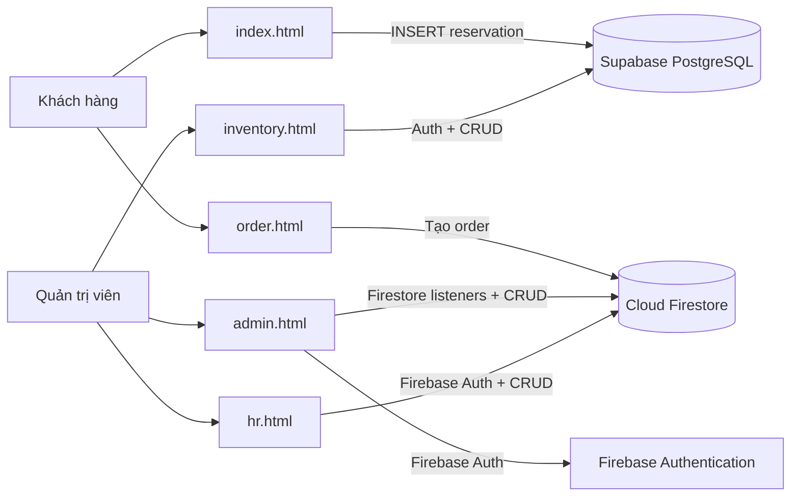

# Kiến trúc Mocha & Miso

**Trạng thái:** Cổng quản trị, gọi món QR và quản lý nhân sự dùng Firebase Auth/Firestore; website đặt bàn và quản lý kho vẫn dùng Supabase.

**Phạm vi:** Website khách, đặt bàn, gọi món QR, quản trị, doanh thu, kho và nhân sự.

## Tổng quan

Frontend là HTML/CSS/JavaScript tĩnh. Cổng quản trị, gọi món QR và HR dùng Firebase Authentication/Cloud Firestore; website đặt bàn và kho dùng Supabase JS từ CDN và cấu hình tại [`../js/supabase.js`](../js/supabase.js). Hai backend hiện chưa đồng bộ.

## Các thành phần và luồng dữ liệu

| Thành phần | Trách nhiệm | Dữ liệu/backend |
|---|---|---|
| [`../index.html`](../index.html), [`../js/main.js`](../js/main.js) | Nội dung khách, gửi đặt bàn, email tùy chọn | Supabase `reservations`; EmailJS |
| [`../order.html`](../order.html), [`../js/order.js`](../js/order.js) | Menu QR, giỏ hàng và gửi đơn | Firestore `orders` |
| [`../admin.html`](../admin.html), [`../admin.js`](../admin.js) | Xử lý đặt bàn/đơn, doanh thu đã thanh toán | Firebase Auth, Firestore `reservations` và `orders` |
| [`../inventory.html`](../inventory.html), [`../js/inventory.js`](../js/inventory.js) | Tồn kho và phiếu nhập/xuất | Supabase `inventory`, `stock_imports`, `stock_exports` |
| [`../hr.html`](../hr.html), [`../hr-auth.js`](../hr-auth.js), [`../employee-management.js`](../employee-management.js), [`../staff-operations.js`](../staff-operations.js) | Hồ sơ, ca, chấm công, bảng lương và báo cáo | Firebase Auth, Firestore `employees`, `employee_shifts`, `employee_attendance`, `employee_payroll` |
| [`../database/supabase-schema.sql`](../database/supabase-schema.sql) | Schema khởi tạo cho project mới | Tập lệnh có `DROP TABLE`, chỉ chạy trên DB trống |
| [`../database/firebase-to-supabase.sql`](../database/firebase-to-supabase.sql) | Migration tăng dần cho DB hiện có | Chính sách RLS, RPC, khóa idempotency và Realtime |
| [`../scripts/migrate-firebase-to-supabase.js`](../scripts/migrate-firebase-to-supabase.js) | Sao chép dữ liệu Firestore cũ | Chỉ import `reservations` và `orders` |

### Đặt bàn

Website khách ghi đặt bàn mới vào Supabase với trạng thái `pending`. Cổng quản trị hiện đọc và cập nhật collection Firestore `reservations`; vì vậy dữ liệu mới trên website không tự hiện trong cổng cho đến khi hai luồng được chuyển về cùng backend hoặc có cơ chế đồng bộ được cấu hình. Firestore Rules phải cấp quyền phù hợp cho tài khoản quản trị.

### Gọi món và doanh thu

Trang QR tạo đơn trực tiếp trong collection Firestore `orders`, gồm mã đơn, số bàn, món/số lượng/giá, tổng tiền, ghi chú và trạng thái ban đầu `new`/`unpaid`. Cổng quản trị đọc collection này theo thời gian thực, cập nhật tiến độ và ghi nhận thanh toán. Doanh thu Firestore chỉ cộng đơn đã thanh toán, theo `paidAt` cho ngày/tháng. Gọi món không cần Supabase URL/anon key hoặc RPC `create_order`.

**Lưu ý bảo mật:** trang QR là luồng khách công khai và ghi trực tiếp Firestore từ trình duyệt. Firestore Security Rules phải cho phép tạo đơn hợp lệ nhưng không cho khách đọc đơn, đổi trạng thái/thanh toán hoặc sửa giá/tổng đã lưu. Quy tắc hiện tại của project Firebase cần được xác minh; dữ liệu đầu vào và giá được tạo ở client trong luồng hiện có, nên trước vận hành thật nên chuyển xác thực giá, giới hạn món/số lượng và chống gửi trùng sang Cloud Function/endpoint đáng tin cậy.

Dashboard quản trị cập nhật `status`, `payment_status` và `paid_at`. Doanh thu chỉ cộng đơn có `payment_status = 'paid'`; tổng theo ngày/tháng căn cứ `paid_at`, còn tổng toàn thời gian cộng mọi đơn đã thanh toán.

### Xác thực và phân quyền

- Cổng quản trị dùng Firebase Auth và giới hạn email quản trị cấu hình trong `admin.js`; Firestore Rules vẫn phải bảo vệ quyền truy cập dữ liệu.
- HR dùng cùng tài khoản Firebase quản trị như cổng quản trị; giao diện giới hạn email quản trị. Firestore Security Rules bắt buộc phải giới hạn đọc/ghi bốn collection HR cho đúng người dùng quản trị; kiểm tra email phía trình duyệt không thay thế Rules.
- Kho dùng phiên Supabase Auth; quyền quản trị được kiểm tra bởi RLS bằng `auth.jwt() -> 'app_metadata' ->> 'role' = 'admin'`.
- Khách chỉ được tạo đặt bàn trên Supabase và gửi đơn QR lên Firestore; không được đọc danh sách khách/đơn hoặc cập nhật trạng thái thanh toán.
- `menu_items` trên Supabase không phải nguồn dữ liệu gọi món QR hiện tại; danh sách món QR đang nằm tĩnh trong `js/order.js`.
- Anon key là khóa public có giới hạn bởi RLS. Service-role key chỉ dùng trong script migration phía máy chủ, không bao giờ trong client.

### Nhân sự

HR dùng Firebase Auth và các collection Firestore `employees`, `employee_shifts`, `employee_attendance`, `employee_payroll`, giữ nguyên tên trường snake_case của giao diện cũ. ID ca, chấm công và lương được tạo xác định theo nhân viên/ngày/ca hoặc nhân viên/tháng để giữ tính upsert; thao tác đổi ca dùng transaction để tránh tạo hai lịch trùng nhau. Dữ liệu HR còn ở Supabase không tự động được sao chép hoặc xóa; schema [`../employee-hr.sql`](../employee-hr.sql) chỉ còn là schema legacy.

## Chuyển dữ liệu Firestore

[`../scripts/migrate-firebase-to-supabase.js`](../scripts/migrate-firebase-to-supabase.js) phân trang hai collection cũ, ánh xạ trường camelCase sang cột snake_case, ghi document ID vào `source_firebase_id` và upsert theo ID đó. Có thể chạy dry-run trước; script không sửa/xóa Firestore và có thể chạy lại sau lỗi giữa chừng.

Mật khẩu/hash Firebase Auth không tương thích để nhập vào Supabase Auth. Tạo user Supabase mới, gán role admin qua `auth.users.raw_app_meta_data`, rồi đặt lại mật khẩu. Đối soát số bản ghi và kiểm tra dữ liệu trước khi ngừng Firebase.

## Triển khai và kiểm chứng

- Phục vụ các file tĩnh qua máy chủ local, GitHub Pages hoặc hosting tĩnh khác; [`../firebase.json`](../firebase.json) vẫn có thể dùng riêng cho Firebase Hosting.
- Cấu hình Firebase web app cho cổng quản trị và URL/anon key Supabase cho các phân hệ Supabase trước khi demo tính năng cloud.
- Chạy `node --test tests/customer-care.test.js tests/table-orders.test.js tests/revenue.test.js tests/hr-auth.test.js tests/admin-auth.test.js tests/firebase-migration.test.js` để kiểm tra các luồng offline/mocked và ánh xạ dữ liệu migration. Kiểm thử đó không thay cho xác nhận live với Supabase.
- Mọi migration dữ liệu thật cần backup Firestore và Supabase trước, tài khoản có quyền đọc nguồn/ghi đích, đối soát số lượng và giữ bản sao nguồn đến khi hoàn tất.
