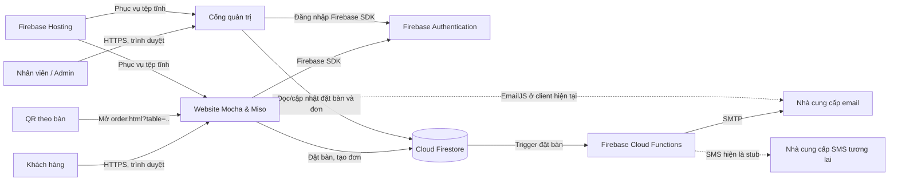
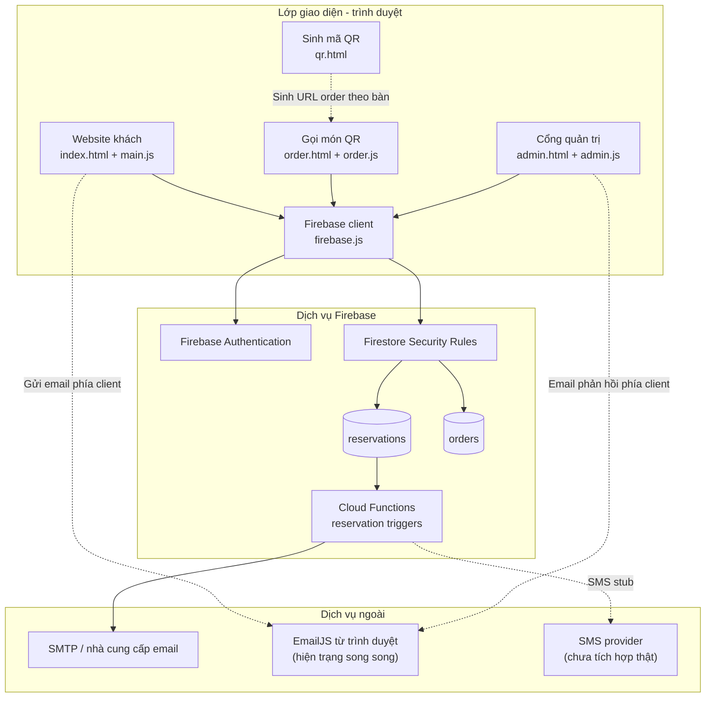
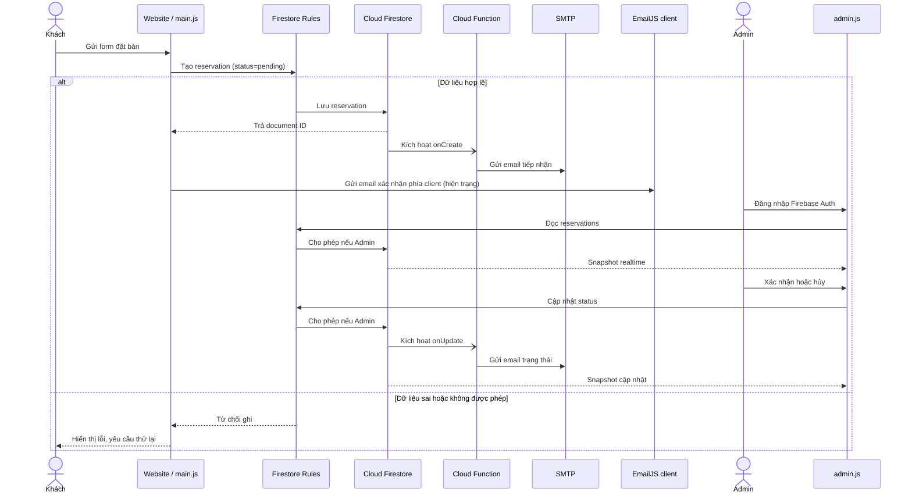
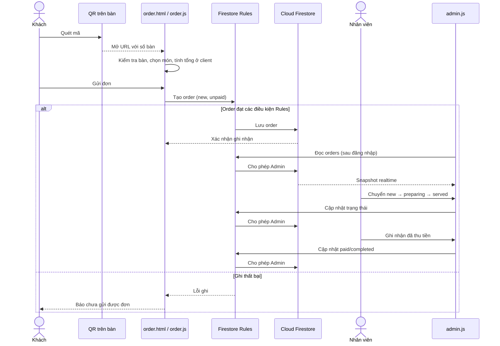
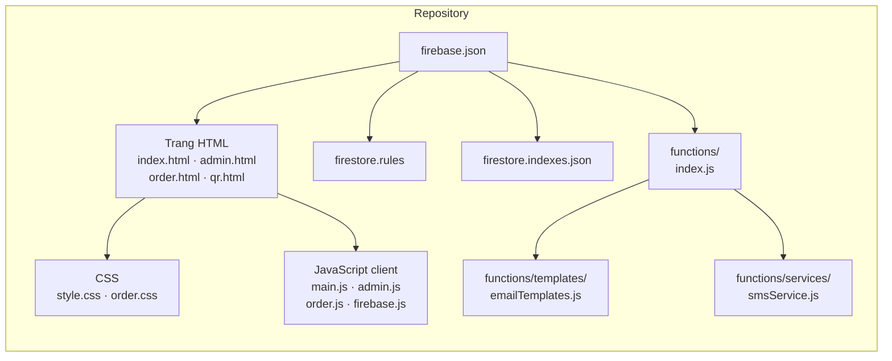
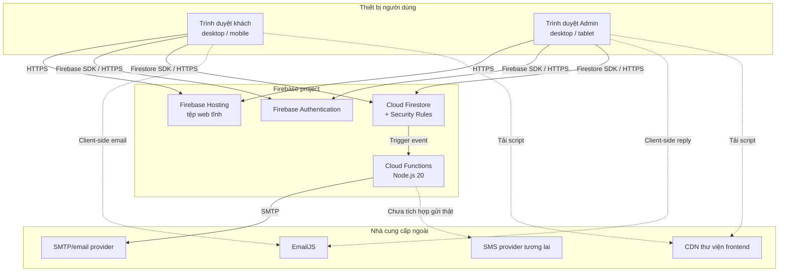
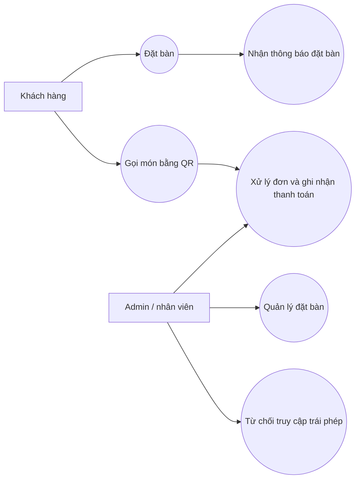

# Tài liệu kiến trúc hệ thống Mocha & Miso

| Thuộc tính | Giá trị |
|---|---|
| Phiên bản | 1.0 |
| Trạng thái | Bản mô tả kiến trúc hiện tại và mục tiêu đề xuất |
| Cơ sở | Mã nguồn repository và các yêu cầu phi chức năng được cung cấp |
| Chuẩn tham chiếu | Cấu trúc mô tả kiến trúc theo ISO/IEC/IEEE 42010 |

> Tài liệu phân biệt **hiện trạng trong mã nguồn** với **mục tiêu cần kiểm thử**. Các ngưỡng mục tiêu không phải kết quả đo hoặc cam kết SLA. Những mục được ghi là đề xuất cần được chủ hệ thống xác nhận trước khi đưa vào vận hành chính thức.

## 1. Mục đích và phạm vi

Mô tả cấu trúc, thành phần, luồng dữ liệu, ranh giới bảo mật và các yêu cầu chất lượng của website Mocha & Miso. Phạm vi gồm website dành cho khách, cổng quản trị, gọi món qua QR, lưu trữ dữ liệu, thông báo email/SMS và triển khai Firebase.

Nguồn mô tả chính: [README.md](../README.md), [firebase.json](../firebase.json), [firebase.js](../firebase.js), [firestore.rules](../firestore.rules), [main.js](../main.js), [admin.js](../admin.js), [order.js](../order.js), [functions/index.js](../functions/index.js) và [functions/services/smsService.js](../functions/services/smsService.js).

## 2. Bối cảnh hệ thống

### 2.1 Các bên liên quan

| Bên liên quan | Nhu cầu chính |
|---|---|
| Khách hàng | Xem thông tin/thực đơn, gửi yêu cầu đặt bàn, gọi món qua QR |
| Nhân viên/quản trị viên | Xem và xử lý đặt bàn, xử lý đơn món, ghi nhận thanh toán tại quầy/bàn |
| Chủ quán/vận hành | Triển khai website, cấu hình Firebase và dịch vụ gửi thông báo |
| Nhà cung cấp dịch vụ | Firebase Hosting, Firebase Authentication, Cloud Firestore, Cloud Functions, SMTP/EmailJS và (nếu tích hợp) nhà cung cấp SMS |

### 2.2 Ranh giới và giả định

- Ứng dụng web là các trang HTML/CSS/JavaScript tĩnh, không có máy chủ ứng dụng riêng trong repository.
- Trình duyệt kết nối trực tiếp với Firebase Authentication và Cloud Firestore bằng Firebase Web SDK dạng compat.
- Cloud Functions xử lý sự kiện thay đổi dữ liệu đặt bàn và gửi email bằng SMTP đã cấu hình.
- Thanh toán hiện được ghi nhận thủ công; không có cổng thanh toán trực tuyến.
- Mã QR định tuyến khách đến trang gọi món kèm số bàn. Khách không cần đăng nhập để gửi đơn.
- Firebase cấu hình trong trình duyệt là cấu hình ứng dụng công khai; quyền truy cập dữ liệu phải được kiểm soát bằng Authentication và Firestore Rules, không dựa vào việc giấu cấu hình ở client.

## 3. Tổng quan kiến trúc

### 3.1 Sơ đồ ngữ cảnh

Đường EmailJS trong sơ đồ phản ánh mã nguồn hiện tại: form đặt bàn và một số thao tác quản trị cũng gửi email từ trình duyệt. Cloud Functions đồng thời gửi email theo trigger Firestore. Hai đường gửi này có thể cùng kích hoạt cho một sự kiện; cần thống nhất một nguồn gửi trước khi coi thông báo là tin cậy.

### 3.2 Thành phần triển khai

| Thành phần | Trách nhiệm | Công nghệ/thực hiện |
|---|---|---|
| Website khách | Nội dung quán, thực đơn, form đặt bàn và hiệu ứng giao diện | `index.html`, `main.js`, `style.css`; HTML/CSS/JavaScript thuần và các thư viện tải từ CDN |
| Cổng quản trị | Đăng nhập, dashboard, theo dõi và cập nhật đặt bàn/đơn gọi món | `admin.html`, `admin.js`; Firebase Auth và Firestore |
| Gọi món QR | Kiểm tra số bàn, hiển thị thực đơn, giỏ món và gửi đơn | `order.html`, `order.js`, `order.css` |
| Sinh mã QR | Tạo URL gọi món theo số bàn | `qr.html`, thư viện QR phía trình duyệt |
| Firebase client | Khởi tạo Firebase App, Auth và Firestore | `firebase.js` |
| Firestore | Lưu đặt bàn và đơn gọi món; gửi cập nhật thời gian thực đến dashboard | Collections `reservations`, `orders`; kiểm soát bằng `firestore.rules` |
| Cloud Functions | Gửi email khi tạo đặt bàn hoặc khi trạng thái được xác nhận/hủy | Node.js 20, Firestore triggers, Nodemailer/SMTP |
| SMS service | Giao diện dịch vụ SMS tùy chọn | Hiện chỉ ghi log/stub; chưa gửi qua Twilio |
| Hosting | Phục vụ nội dung tĩnh và cấu hình runtime Functions | Firebase Hosting |

### 3.3 Các luồng chính

**Đặt bàn**

1. Khách nhập thông tin trên form ở website.
2. Client kiểm tra trường bắt buộc, tạo dữ liệu với trạng thái `pending` và ghi vào `reservations`.
3. Firestore Rules cho phép tạo đặt bàn công khai nếu dữ liệu đạt điều kiện; quyền đọc dành cho tài khoản Admin được xác định trong rules.
4. Admin nhận cập nhật qua listener thời gian thực và có thể xác nhận, hủy hoặc xóa.
5. Firestore trigger gửi email qua SMTP khi tạo hoặc đổi trạng thái. Client hiện cũng có luồng gửi EmailJS; xem rủi ro ở mục 9.

**Gọi món qua QR**

1. QR mở `order.html` với tham số `table`.
2. Client kiểm tra số bàn, hiển thị thực đơn tĩnh, tính giỏ món và ghi đơn vào `orders`.
3. Firestore Rules cho phép tạo đơn không cần đăng nhập với giới hạn trường/giá trị cơ bản; chỉ Admin được đọc, cập nhật và xóa đơn.
4. Dashboard Admin nhận đơn theo thời gian thực. Nhân viên chuyển trạng thái từ mới sang đang làm, đã phục vụ; sau khi thu tiền, cập nhật trạng thái thanh toán và hoàn tất đơn.

**Quản trị**

1. Người dùng đăng nhập bằng Firebase Authentication email/mật khẩu.
2. Client chỉ hiển thị dashboard nếu email trùng email Admin cấu hình trong `admin.js`.
3. Firestore Rules kiểm tra email trong auth token trước khi cho phép đọc và thay đổi dữ liệu quản trị.

## 4. Các góc nhìn kiến trúc theo phương pháp 4+1

Phương pháp 4+1 mô tả cùng một kiến trúc qua bốn góc nhìn bổ trợ nhau và một góc nhìn kịch bản để kiểm chứng cách các phần phối hợp. Các sơ đồ dưới đây mô tả hiện trạng mã nguồn; các hạn chế và mục tiêu cần hoàn thiện được nêu riêng để không nhầm với chức năng đã triển khai.

### 4.1 Góc nhìn logic (Logical View)

Góc nhìn logic tập trung vào các trách nhiệm chức năng và quan hệ giữa giao diện, dịch vụ Firebase và dữ liệu. Các trang khách và Admin là những client riêng; Firestore Rules là ranh giới phân quyền cho truy cập dữ liệu trực tiếp từ trình duyệt.

**Trách nhiệm và ranh giới:**

- Giao diện chịu trách nhiệm hiển thị, kiểm tra đầu vào cơ bản và gửi lệnh; không phải ranh giới tin cậy để quyết định quyền truy cập.
- Firestore Rules thực thi quyền truy cập dữ liệu. Firebase Auth cung cấp danh tính; hiện Admin được nhận diện bằng email cố định.
- Cloud Functions phản ứng với sự kiện đặt bàn và gửi email SMTP. EmailJS vẫn được gọi từ client ở một số luồng, do đó cần chọn một cơ chế gửi chuẩn.
- Món ăn và giá gọi món hiện được định nghĩa trong client; Rules chưa bảo đảm giá/tổng tiền client gửi là đúng.

### 4.2 Góc nhìn tiến trình (Process View)

Góc nhìn tiến trình mô tả tương tác theo thời gian, cập nhật realtime, xác thực và các nhánh lỗi quan trọng. Các biểu đồ mô tả luồng chính, không hàm ý có API server riêng.

**Đặt bàn và thông báo**

**Gọi món, xử lý và thanh toán thủ công**

**Đặc tính tiến trình hiện trạng:** listener Firestore cập nhật dashboard khi dữ liệu thay đổi; thao tác tạo đơn có thông báo lỗi nếu ghi thất bại. Chưa có cơ chế hàng đợi ghi ngoại tuyến hay bảo đảm retry idempotent cho thao tác ghi/gửi email. Việc cập nhật trạng thái đơn được kiểm soát chủ yếu bằng quyền Admin, chưa giới hạn đầy đủ state transition trong Rules.

### 4.3 Góc nhìn phát triển (Development View)

Góc nhìn phát triển mô tả phân rã mã nguồn và ranh giới triển khai phần mềm. Repository hiện dùng các script trình duyệt thông thường, không có hệ thống module frontend/build riêng.

| Nhóm mã nguồn | Thành phần | Phụ thuộc/chú ý |
|---|---|---|
| Trang khách | `index.html`, `main.js`, `style.css` | Firebase SDK, EmailJS và thư viện hiệu ứng/CDN |
| Admin | `admin.html`, `admin.js` | Firebase Auth, Firestore, EmailJS |
| Gọi món QR | `order.html`, `order.js`, `order.css` | Firebase Firestore; dữ liệu menu nằm phía client |
| Sinh QR | `qr.html` | Thư viện QR tải phía trình duyệt |
| Khởi tạo backend client | `firebase.js` | Khởi tạo Firebase App/Auth/Firestore |
| Backend sự kiện | `functions/index.js`, `templates/`, `services/` | Node.js 20, Firebase Functions/Admin SDK, Nodemailer, SMTP |
| Cấu hình truy cập/triển khai | `firestore.rules`, `firebase.json`, `firestore.indexes.json` | Rules là chính sách bắt buộc; index bổ sung hiện chưa khai báo |

### 4.4 Góc nhìn vật lý/triển khai (Physical View)

Góc nhìn vật lý mô tả các node runtime và kết nối mạng. Dịch vụ Firebase được dùng như dịch vụ quản lý; browser gọi trực tiếp Auth/Firestore, còn Functions chạy khi có sự kiện database.

**Triển khai và ranh giới tin cậy:**

- `firebase.json` cấu hình Hosting phục vụ thư mục tĩnh và Functions runtime Node.js 20; Functions triển khai cùng Firebase project nhưng thực thi ở môi trường backend.
- Kết nối trình duyệt đến Hosting/Auth/Firestore và CDN cần HTTPS. Quyền Firestore được đánh giá ở Rules cho từng request.
- Thông tin SMTP/Twilio thật không đặt trong bundle frontend; `.env.example` chỉ là mẫu. Cần bảo đảm secrets production được cấu hình riêng, không commit.
- CDN, Firebase và nhà cung cấp SMTP là phụ thuộc ngoài; sự cố ở các dịch vụ này có thể ảnh hưởng tải trang, thao tác realtime hoặc thông báo.
- Topology môi trường (development/staging/production), backup, logging/alerting và quy trình rollback chưa được cấu hình/miêu tả đầy đủ trong repository.

### 4.5 Góc nhìn kịch bản (+1)

Các kịch bản tiêu biểu dưới đây vừa mô tả hành vi người dùng vừa kiểm chứng các góc nhìn logic, tiến trình, phát triển và triển khai.

| Kịch bản | Tác nhân và kết quả mong đợi | Thành phần liên quan | Góc nhìn được kiểm chứng |
|---|---|---|---|
| S1 — Đặt bàn thành công | Khách gửi dữ liệu hợp lệ; bản ghi `pending` được lưu và dashboard nhận được cập nhật | `main.js`, Firestore Rules, `reservations`, `admin.js` | Logic, tiến trình, phát triển |
| S2 — Thông báo đặt bàn | Khi đặt bàn được tạo/đổi trạng thái, email được gửi và kết quả được ghi nhận; không gửi trùng | Firestore trigger, Cloud Functions, SMTP, EmailJS client | Tiến trình, triển khai, độ tin cậy |
| S3 — Gọi món từ QR | Khách quét QR đúng bàn, chọn món và nhận mã đơn sau khi ghi thành công | `qr.html`, `order.html`, `order.js`, Rules, `orders` | Logic, tiến trình, triển khai |
| S4 — Nhân viên xử lý đơn | Admin xem đơn realtime, chuyển trạng thái theo luồng phục vụ và ghi nhận thanh toán tại chỗ | Firebase Auth, `admin.js`, Firestore Rules, `orders` | Logic, tiến trình, bảo mật |
| S5 — Từ chối truy cập trái phép | Người không phải Admin không đọc/sửa/xóa dữ liệu quản trị kể cả khi gọi Firestore ngoài giao diện | Firebase Auth, Firestore Rules | Logic, bảo mật, triển khai |
| S6 — Mất kết nối dịch vụ | Client báo lỗi rõ ràng, không báo thành công giả; khi kết nối lại người dùng có thể xác minh trạng thái và thử lại an toàn | Trang khách/order, Firestore, Functions/SMTP | Tiến trình, triển khai, độ tin cậy |

Các kịch bản này là cơ sở cho kiểm thử chấp nhận; kết quả đạt/chưa đạt cần được ghi nhận trong môi trường thử nghiệm riêng. S2 và S6 hiện cần bổ sung kiểm thử idempotency/retry và xử lý lỗi nhất quán.

### 4.6 Ma trận truy vết 4+1

| Yêu cầu/kịch bản | Logic | Tiến trình | Phát triển | Vật lý | Kịch bản |
|---|---|---|---|---|---|
| Đặt bàn | `reservations`, Rules, UI | S1, S2 | `main.js`, Functions | Hosting, Firestore, SMTP | S1, S2 |
| Gọi món QR | `orders`, Rules, UI | S3, S4 | `order.js`, `admin.js` | Browser, Firestore | S3, S4 |
| Bảo vệ dữ liệu Admin | Auth và Rules | S4, S5 | `firestore.rules`, `admin.js` | Auth/Firestore project | S5 |
| Hiệu năng và khả dụng | Client trực tiếp gọi dịch vụ | S1, S3, S6 | Trang client/SDK | Hosting, Firebase/CDN | S1, S3, S6 |
| Email và phục hồi | Functions/SMTP, trạng thái email | S2, S6 | `functions/index.js` | Functions, SMTP | S2, S6 |

## 5. Dữ liệu và tích hợp

| Collection | Dữ liệu chính | Quyền theo rules hiện tại |
|---|---|---|
| `reservations` | Tên, email, ngày/giờ, số khách, ghi chú, trạng thái, mã đặt bàn và trạng thái email | Khách có thể tạo nếu đạt kiểm tra; chỉ Admin đọc/cập nhật/xóa |
| `orders` | Mã đơn, số bàn, món, tổng tiền, ghi chú, trạng thái đơn/thanh toán và thời điểm | Khách có thể tạo nếu đạt kiểm tra; chỉ Admin đọc/cập nhật/xóa |

Firestore Indexes hiện chưa khai báo index bổ sung. Dữ liệu đặt bàn cũ trong `localStorage` có thể được dùng làm dữ liệu dự phòng cục bộ trong dashboard khi Firestore không khả dụng; dữ liệu này không đồng bộ giữa các thiết bị và không thay thế nguồn dữ liệu Firestore.

## 6. Quyết định kiến trúc và ràng buộc

| Mã | Quyết định/ràng buộc | Hệ quả |
|---|---|---|
| ADR-01 | Dùng Firebase Hosting cho website tĩnh | Đơn giản hóa triển khai; client kết nối trực tiếp các dịch vụ Firebase |
| ADR-02 | Dùng Firestore cho dữ liệu đặt bàn/đơn và cập nhật realtime | Dashboard nhận thay đổi tức thời; mọi quyền truy cập phụ thuộc rules và cấu hình Firebase |
| ADR-03 | Dùng Firebase Auth email/mật khẩu cho Admin | Không cần tự quản lý mật khẩu; email Admin đang được cấu hình cố định trong client và Rules |
| ADR-04 | Cho phép khách gửi đơn/đặt bàn công khai | Giảm ma sát sử dụng nhưng làm tăng yêu cầu kiểm tra dữ liệu, giới hạn lạm dụng và bảo vệ chi phí |
| ADR-05 | Không tích hợp thanh toán trực tuyến | Trạng thái thanh toán do nhân viên cập nhật sau khi thu tiền trực tiếp |
| ADR-06 | Gửi email qua SMTP trong Cloud Functions; EmailJS vẫn tồn tại ở client | Có khả năng gửi trùng và ghi trạng thái email cạnh tranh; cần một nguồn gửi chuẩn duy nhất |

## 7. Yêu cầu phi chức năng và kịch bản nghiệm thu

### 7.1 Hiệu năng (Performance)

**Hiện trạng:** Frontend có một số biện pháp giảm chi phí hiển thị như tải ảnh thực đơn lazy, `defer` cho script và debounce một số sự kiện resize. Chưa có bằng chứng trong repository về benchmark tải, giám sát SLI/SLO hoặc báo cáo dung lượng chịu tải. Các thao tác chính gọi trực tiếp Firestore SDK; không có REST API đặt món riêng.

**Mục tiêu nghiệm thu:**

| Kịch bản | Tiêu chí đạt | Cách kiểm thử |
|---|---|---|
| Tải cao điểm với luồng tạo đơn/đặt bàn | Đạt 50 yêu cầu/giây trong bài kiểm thử; tỷ lệ lỗi dưới 1%; thời gian phản hồi trung bình dưới 1,5 giây | Chạy JMeter/k6 trên môi trường staging với tài khoản và dữ liệu kiểm thử; đo thao tác end-to-end qua Firebase SDK/API phù hợp, không giả định có REST endpoint riêng |
| Tải trang khách, Admin và gọi món | Các trang hiển thị chức năng cốt lõi, không lỗi script; ghi nhận thời gian tải và lỗi tài nguyên CDN/Firebase | Kiểm thử trình duyệt và đo bằng Lighthouse/Web Vitals trên các trang triển khai |
| Tăng tải dashboard realtime | Listener xử lý được dữ liệu kiểm thử mà không làm mất cập nhật hoặc treo giao diện | Phát sinh đơn/đặt bàn đồng thời ở staging và đối chiếu số ghi với số hiển thị |

Ngưỡng tải nêu trên là mục tiêu cần kiểm chứng, không phải năng lực đã được đo. Không chạy tải lớn trên production nếu chưa đánh giá chi phí và có giới hạn kiểm soát.

### 7.2 Bảo mật (Security)

**Hiện trạng:** Firebase Auth email/mật khẩu dùng cho Admin; Firestore Rules giới hạn quyền đọc và cập nhật/xóa dữ liệu quản trị. Tạo đặt bàn và đơn hàng được mở công khai với kiểm tra dữ liệu cơ bản. Cấu hình bí mật Functions được hướng dẫn qua `.env.example`; cấu hình Firebase web được nhúng phía client như thông lệ Firebase.

**Mục tiêu và tiêu chí nghiệm thu:**

- Tài khoản không phải Admin không đọc được danh sách đặt bàn/đơn, không thay đổi trạng thái, không xóa dữ liệu, kể cả khi gọi Firestore trực tiếp ngoài giao diện.
- Client không được xem là ranh giới phân quyền; quyền phải được thực thi trong Rules hoặc backend tin cậy.
- Kiểm thử tạo đặt bàn và đơn với dữ liệu thiếu/sai kiểu, số lượng vượt giới hạn, trạng thái tự xác nhận hoặc số bàn sai định dạng; yêu cầu không hợp lệ bị từ chối.
- Xác minh `.env`, mật khẩu SMTP, token và thông tin bí mật không được commit; `.gitignore` phải loại trừ file môi trường thực tế.
- Dùng HTTPS khi triển khai; phân quyền quyền truy cập project Firebase, giới hạn tài khoản Admin và luân chuyển thông tin xác thực khi có sự cố.
- Chạy kiểm thử bảo mật Rules (Firebase Emulator hoặc môi trường staging) cho cả quyền được phép và bị từ chối.

**Lưu ý cần xử lý:** Admin hiện đang xác định bằng email cố định ở client và Rules; đây là cách giới hạn một tài khoản, chưa phải mô hình vai trò mở rộng. Rules cho `orders` kiểm tra một số thuộc tính tạo đơn nhưng chưa chứng minh tính nhất quán giữa giá từng món và tổng tiền, cũng chưa ràng buộc chặt các chuyển trạng thái khi cập nhật.

### 7.3 Tính khả dụng và khả năng tiếp cận (Usability & Accessibility)

**Hiện trạng:** Các trang có viewport mobile; CSS có breakpoint cho gọi món, website có menu thu gọn. Form đăng nhập và đặt bàn có phản hồi lỗi; trang order có nhãn bàn, trạng thái đơn và nút điều khiển số lượng có tên hỗ trợ. Chưa có báo cáo kiểm toán khả năng tiếp cận.

**Mục tiêu và tiêu chí nghiệm thu:**

- Luồng đặt bàn và gọi món sử dụng được trên Chrome DevTools với kích thước iPad Air và iPhone 12; không tràn ngang, nội dung hoặc nút hành động không bị che.
- Các nút “Thêm món”, “Thanh toán/Đã thanh toán” và các nút xử lý đơn hiển thị đủ, có thể thao tác bằng cảm ứng và bàn phím.
- Đạt WCAG 2.1 AA cho các luồng trọng yếu: điều khiển bằng bàn phím, focus nhìn thấy, label/accessible name, thông báo lỗi/trạng thái đọc được bằng công nghệ hỗ trợ, tương phản màu phù hợp.
- Nội dung không phụ thuộc duy nhất vào màu sắc/animation; thao tác chính vẫn dùng được khi script hiệu ứng bên thứ ba không tải.
- Kiểm thử thủ công trên trình duyệt desktop và thiết bị di động, bổ sung kiểm tra tự động accessibility cho các luồng chính.

### 7.4 Độ tin cậy và phục hồi (Reliability & Recoverability)

**Hiện trạng:** Firestore listener cập nhật dữ liệu Admin theo thời gian thực và báo lỗi tải; form gọi món hiển thị lỗi khi ghi thất bại. Dashboard có dự phòng localStorage cho đặt bàn trong một số trường hợp. Cloud Function ghi trạng thái gửi email và có log lỗi. Repository chưa mô tả backup/restore, giám sát availability, quy trình xử lý sự cố hoặc mức RPO/RTO.

**Mục tiêu và tiêu chí nghiệm thu:**

- Khi mất kết nối Firestore, không hiển thị thao tác ghi thất bại như thành công; người dùng nhận thông báo và có cách thử lại an toàn.
- Kiểm thử refresh/trở lại trang sau khi kết nối được khôi phục; dữ liệu đã lưu bền vững trên Firestore vẫn được tải lại chính xác.
- Đăng nhập Admin, để phiên không hoạt động 30 phút, sau đó refresh hoặc gọi thao tác được bảo vệ: yêu cầu xác thực lại. Cần cấu hình/triển khai cơ chế timeout rõ ràng; chưa thấy logic 30 phút trong mã nguồn hiện tại.
- Email lỗi không làm mất bản ghi đặt bàn; trạng thái email phản ánh rõ gửi thành công/thất bại. Cần đảm bảo việc retry không tạo gửi trùng.
- **Mục tiêu vận hành đề xuất cần chủ hệ thống xác nhận:** availability 99,5% theo tháng; RPO không quá 24 giờ; RTO không quá 4 giờ. Thiết lập backup Firestore, cảnh báo lỗi và diễn tập khôi phục trước khi xem các ngưỡng này là cam kết.
- Không ghi thông tin nhạy cảm hoặc dữ liệu cá nhân không cần thiết vào log; xác định thời hạn lưu trữ và quy trình phục hồi/xóa dữ liệu.

## 8. Môi trường và triển khai

- **Hosting:** Firebase Hosting phục vụ thư mục gốc; `firebase.json` loại `functions/**` và `node_modules` khỏi nội dung hosting.
- **Functions:** Node.js 20, mã nguồn tại `functions/`; triển khai riêng qua Firebase CLI.
- **Cấu hình:** SMTP/Twilio được mô tả trong `functions/.env.example`. Không đưa giá trị bí mật vào source control; quản lý giá trị thật bằng secrets/configuration của môi trường triển khai.
- **Phụ thuộc runtime ngoài:** Firebase SDK, GSAP, ScrollTrigger, SplitType, Lenis, EmailJS và thư viện QR được tải qua CDN. Cần theo dõi khả năng sẵn sàng và thay đổi phiên bản từ các CDN.
- **Môi trường khuyến nghị:** local/emulator cho phát triển Rules và Functions; staging để nghiệm thu; production tách biệt dữ liệu, credentials và quyền truy cập. Không dùng thông tin khách thật cho thử tải.

## 9. Rủi ro, điểm cần xác nhận và hướng hoàn thiện

| Ưu tiên | Quan sát từ mã nguồn | Tác động/đề xuất |
|---|---|---|
| Cao | EmailJS ở client và trigger Cloud Functions cùng gửi email đặt bàn/trạng thái | Có thể gửi trùng hoặc ghi đè `emailStatus`; chọn một đường gửi làm nguồn chuẩn và kiểm thử idempotency |
| Cao | Chưa thấy cơ chế hết hạn phiên 30 phút | Bổ sung chính sách timeout phía Auth/ứng dụng và kiểm thử lại quyền truy cập trực tiếp |
| Cao | Rules đơn hàng chưa ràng buộc schema item, tổng tiền khớp giá, hoặc state transition | Kiểm tra phía backend tin cậy hoặc tăng cường Rules; không tin giá/tổng do client gửi |
| Cao | Tạo đặt bàn/đơn công khai có thể bị lạm dụng | Đánh giá Firebase App Check, quota/rate controls, giới hạn kích thước dữ liệu và giám sát chi phí |
| Trung bình | SMS service hiện là stub dù trả về trạng thái thành công giả lập trong nhánh có credentials | Không mô tả SMS là tính năng đã giao; tích hợp provider thật hoặc báo trạng thái “chưa hỗ trợ” |
| Trung bình | localStorage dự phòng chỉ có trên thiết bị hiện tại | Tránh dùng dữ liệu local như nguồn dữ liệu vận hành; hiển thị rõ trạng thái đồng bộ và quy trình đối soát |
| Trung bình | Form đặt bàn giới hạn số khách tối đa 12, trong khi Firestore Rules cho phép đến 20 | Thống nhất giới hạn nghiệp vụ giữa giao diện và Rules để tránh chênh lệch hành vi giữa client và dữ liệu được chấp nhận |
| Trung bình | Chưa có cấu hình backup/restore và kiểm thử khôi phục trong repository | Thiết lập backup, phân quyền và diễn tập khôi phục trước khi cam kết RPO/RTO |
| Trung bình | Phụ thuộc nhiều CDN và có lỗi fallback khác nhau giữa các trang | Kiểm tra lỗi tải CDN, giảm phụ thuộc hoặc tự host thư viện thiết yếu; đảm bảo chức năng cốt lõi hoạt động |
| Trung bình | Chưa có kết quả đo hiệu năng và accessibility | Tạo baseline Lighthouse/Web Vitals, test tải staging và kiểm thử WCAG cho luồng cốt lõi |

## 10. Kế hoạch xác minh kiến trúc

1. **Rules/security:** kiểm thử quyền khách, Admin và người chưa xác thực cho cả hai collections, gồm payload không hợp lệ.
2. **Luồng chức năng:** đặt bàn → Admin xác nhận/hủy → trạng thái và email; QR → gửi món → cập nhật bếp/phục vụ → ghi nhận thanh toán.
3. **Hiệu năng:** chạy benchmark staging theo ngưỡng tại mục 6.1, lưu script, dữ liệu, thời gian chạy, tỷ lệ lỗi và thời gian phản hồi.
4. **Responsive/accessibility:** kiểm thử thiết bị/kích thước mục tiêu, bàn phím, screen reader cơ bản, focus, label, lỗi và tương phản.
5. **Phục hồi:** mô phỏng lỗi mạng/Firebase/SMTP; khôi phục backup trên môi trường riêng; xác minh timeout phiên và khả năng thao tác lại.
6. **Vận hành:** rà soát log/alert, secret management, quy trình triển khai/rollback và phân quyền Firebase trước mỗi bản phát hành lớn.

## 11. Tài liệu tham chiếu trong repository

- [README.md](../README.md) — chức năng, công nghệ và quy trình vận hành.
- [firebase.json](../firebase.json) — cấu hình Hosting và Functions.
- [firestore.rules](../firestore.rules) — quyền truy cập Firestore.
- [firebase.js](../firebase.js) — khởi tạo Firebase phía trình duyệt.
- [functions/.env.example](../functions/.env.example) — tên biến cấu hình dịch vụ.
- [functions/index.js](../functions/index.js) — trigger email đặt bàn.
- [functions/services/smsService.js](../functions/services/smsService.js) — dịch vụ SMS hiện tại.
