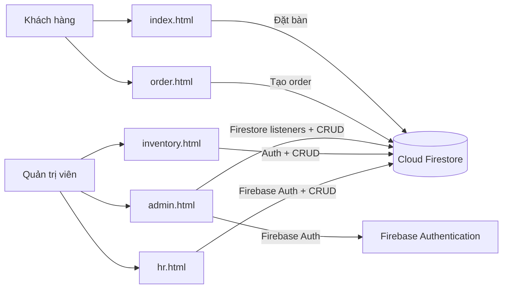

# Kiến trúc Mocha & Miso

**Trạng thái:** Cổng quản trị, đặt bàn, gọi món QR, quản lý nhân sự và giao diện kho dùng Firebase Auth/Firestore. Kho Supabase là nguồn dữ liệu legacy cần được di trú và đối soát trước khi gỡ các thành phần cũ.

**Phạm vi:** Website khách, đặt bàn, gọi món QR, quản trị, doanh thu, kho và nhân sự.

## Tổng quan

Frontend là HTML/CSS/JavaScript tĩnh. Các phân hệ đang hoạt động dùng chung Firebase Authentication/Cloud Firestore. Trang kho kết nối Firebase qua cấu hình dùng chung; các file Supabase client, schema và dữ liệu nguồn vẫn được giữ lại cho đến khi migration kho được chạy và đối soát.

## Các thành phần và luồng dữ liệu

| Thành phần | Trách nhiệm | Dữ liệu/backend |
|---|---|---|
| [`../index.html`](../index.html), [`../js/main.js`](../js/main.js) | Nội dung khách, gửi đặt bàn, email tùy chọn | Firestore `reservations`; EmailJS |
| [`../order.html`](../order.html), [`../js/order.js`](../js/order.js) | Menu QR, giỏ hàng và gửi đơn | Firestore `orders` |
| [`../admin.html`](../admin.html), [`../revenue.html`](../revenue.html), [`../admin.js`](../admin.js) | Xử lý đặt bàn/đơn, doanh thu đã thanh toán | Firebase Auth, Firestore `reservations` và `orders` |
| [`../inventory.html`](../inventory.html), [`../js/inventory.js`](../js/inventory.js) | Tồn kho, cảnh báo thấp, phiếu nhập/xuất | Firebase Auth, Firestore `inventory`, `stock_imports`, `stock_exports` |
| [`../hr.html`](../hr.html), [`../hr-auth.js`](../hr-auth.js), [`../employee-management.js`](../employee-management.js), [`../staff-operations.js`](../staff-operations.js) | Hồ sơ, ca, chấm công, bảng lương và báo cáo | Firebase Auth, Firestore `employees`, `employee_shifts`, `employee_attendance`, `employee_payroll` |
| [`../database/supabase-schema.sql`](../database/supabase-schema.sql) | Schema legacy Supabase | Không chạy lại trên dữ liệu thật; có `DROP TABLE` |
| [`../database/firebase-to-supabase.sql`](../database/firebase-to-supabase.sql) | Migration tăng dần cho DB hiện có | Chính sách RLS, RPC, khóa idempotency và Realtime |
| [`../scripts/migrate-firebase-to-supabase.js`](../scripts/migrate-firebase-to-supabase.js) | Sao chép dữ liệu Firestore cũ | Chỉ import `reservations` và `orders` |
| [`../scripts/migrate-supabase-inventory-to-firestore.js`](../scripts/migrate-supabase-inventory-to-firestore.js) | Sao chép dữ liệu kho legacy | Không xóa nguồn, không ghi đè tài liệu đích đã tồn tại |

### Đặt bàn

Website khách ghi yêu cầu đặt bàn vào Firestore `reservations` với trạng thái `pending`; cổng quản trị đọc và xử lý cùng collection.

### Gọi món và doanh thu

Trang QR tạo đơn trực tiếp trong collection Firestore `orders`, gồm mã đơn, số bàn, món/số lượng/giá, tổng tiền, ghi chú và trạng thái ban đầu `new`/`unpaid`. Cổng quản trị đọc collection này theo thời gian thực, cập nhật tiến độ và ghi nhận thanh toán. Doanh thu Firestore chỉ cộng đơn đã thanh toán, theo `paidAt` cho ngày/tháng. Gọi món không cần Supabase URL/anon key hoặc RPC `create_order`.

**Lưu ý bảo mật:** trang QR là luồng khách công khai và ghi trực tiếp Firestore từ trình duyệt. Firestore Security Rules phải cho phép tạo đơn hợp lệ nhưng không cho khách đọc đơn, đổi trạng thái/thanh toán hoặc sửa giá/tổng đã lưu. Quy tắc hiện tại của project Firebase cần được xác minh; dữ liệu đầu vào và giá được tạo ở client trong luồng hiện có, nên trước vận hành thật nên chuyển xác thực giá, giới hạn món/số lượng và chống gửi trùng sang Cloud Function/endpoint đáng tin cậy.

Dashboard quản trị cập nhật `status`, `payment_status` và `paid_at`. Giá món và tổng đơn được lưu bằng VND nguyên (`currencyUnit: 'VND'`); dữ liệu cũ không có đơn vị được đọc là VND, còn dữ liệu đơn vị nghìn VND phải được đánh dấu tường minh `VND_THOUSANDS`. Doanh thu chỉ cộng đơn có `payment_status = 'paid'`; ngày/tháng được tính theo múi giờ nghiệp vụ `Asia/Ho_Chi_Minh` từ `paid_at`, còn tổng toàn thời gian cộng mọi đơn đã thanh toán.

`admin.js` là entry point duy nhất cho cổng quản trị và trang doanh thu. `revenue.html` không tải thêm một bản sao script quản trị. `js/main.js` chỉ là entry point website khách hàng; không có root-level `main.js`.

### Xác thực và phân quyền

- Cổng quản trị dùng Firebase Auth và giới hạn email quản trị cấu hình trong `admin.js`; Firestore Rules vẫn phải bảo vệ quyền truy cập dữ liệu.
- HR dùng cùng tài khoản Firebase quản trị như cổng quản trị; giao diện giới hạn email quản trị. Firestore Security Rules bắt buộc phải giới hạn đọc/ghi bốn collection HR cho đúng người dùng quản trị; kiểm tra email phía trình duyệt không thay thế Rules.
- Kho dùng cùng Firebase Auth với Admin; giao diện chỉ mở cho email admin đã cấu hình, và Firestore Rules giới hạn đọc/ghi `inventory`, `stock_imports`, `stock_exports` bằng `isAdmin()`. Kiểm tra phía trình duyệt không thay thế Rules.
- Khách chỉ được tạo đặt bàn và gửi đơn QR lên Firestore; không được đọc danh sách khách/đơn hoặc cập nhật trạng thái thanh toán.
- `menu_items` trên Supabase không phải nguồn dữ liệu gọi món QR hiện tại; danh sách món QR đang nằm tĩnh trong `js/order.js`.
- Anon key là khóa public có giới hạn bởi RLS. Service-role key chỉ dùng trong script migration phía máy chủ, không bao giờ trong client.

### Nhân sự

HR dùng Firebase Auth và các collection Firestore `employees`, `employee_shifts`, `employee_attendance`, `employee_payroll`, giữ nguyên tên trường snake_case của giao diện cũ. ID ca, chấm công và lương được tạo xác định theo nhân viên/ngày/ca hoặc nhân viên/tháng để giữ tính upsert; thao tác đổi ca dùng transaction để tránh tạo hai lịch trùng nhau. Dữ liệu HR còn ở Supabase không tự động được sao chép hoặc xóa; schema [`../employee-hr.sql`](../employee-hr.sql) chỉ còn là schema legacy.

## Chuyển dữ liệu Firestore

### Di trú dữ liệu kho Supabase

Giao diện kho đã chuyển sang Firestore; source Supabase vẫn được giữ nguyên và migration production chưa được chạy trong môi trường này. Không đưa giao diện mới vào vận hành với dữ liệu thật trước khi sao lưu, tạm dừng ghi vào Supabase, chạy migration và đối soát. Script [`../scripts/migrate-supabase-inventory-to-firestore.js`](../scripts/migrate-supabase-inventory-to-firestore.js) đọc ba bảng Supabase theo trang, ánh xạ mã/tồn kho/giá/nhà cung cấp và lịch sử nhập/xuất sang các collection tương ứng. ID cũ được ánh xạ xác định để chạy lại; tài liệu Firestore đã tồn tại được bỏ qua. `--dry-run` chỉ đếm bản ghi có thể sao chép. Script không cập nhật hoặc xóa dữ liệu nguồn.

Trước khi chạy migration thật, sao lưu hai backend; dùng phiên Supabase admin chỉ đọc và Firebase Admin credentials cho **project đang cấu hình trong `.firebaserc`**; chạy dry-run, di trú, đối soát số lượng/trường dữ liệu và kiểm thử quyền Rules. Chỉ sau khi xác nhận thành công mới gỡ Supabase SDK/client và schema cũ. Chưa thực hiện migration live hoặc deploy Rules trong môi trường này.

Collection kho dùng trường `code`, `name`, `category`, `quantity`, `unit`, `price` (VND), `min_stock`, `received_at` (ngày `YYYY-MM-DD`), `supplier`, `created_at`, `updated_at`. Mỗi phiếu nhập/xuất là một document riêng có `item_id`, chi tiết số lượng/đơn giá/người thao tác và `created_at`. Nhập/xuất dùng transaction để cập nhật tồn kho cùng lúc với ghi phiếu.

[`../scripts/migrate-firebase-to-supabase.js`](../scripts/migrate-firebase-to-supabase.js) phân trang hai collection cũ, ánh xạ trường camelCase sang cột snake_case, ghi document ID vào `source_firebase_id` và upsert theo ID đó. Có thể chạy dry-run trước; script không sửa/xóa Firestore và có thể chạy lại sau lỗi giữa chừng.

Mật khẩu/hash Firebase Auth không tương thích để nhập vào Supabase Auth. Tạo user Supabase mới, gán role admin qua `auth.users.raw_app_meta_data`, rồi đặt lại mật khẩu. Đối soát số bản ghi và kiểm tra dữ liệu trước khi ngừng Firebase.

## Triển khai và kiểm chứng

- Phục vụ các file tĩnh qua máy chủ local, GitHub Pages hoặc hosting tĩnh khác; [`../firebase.json`](../firebase.json) vẫn có thể dùng riêng cho Firebase Hosting.
- Cấu hình Firebase web app cho các phân hệ. Supabase client, migration và schema legacy không được gỡ cho đến khi hoàn tất đối soát dữ liệu kho.
- Chạy `node --test tests/customer-care.test.js tests/table-orders.test.js tests/revenue.test.js tests/hr-auth.test.js tests/admin-auth.test.js tests/firebase-migration.test.js` để kiểm tra các luồng offline/mocked và ánh xạ dữ liệu migration. Kiểm thử đó không thay cho xác nhận live với Supabase.
- Mọi migration dữ liệu thật cần backup nguồn/đích, tài khoản có quyền phù hợp, đối soát số lượng và giữ bản sao nguồn đến khi hoàn tất.
