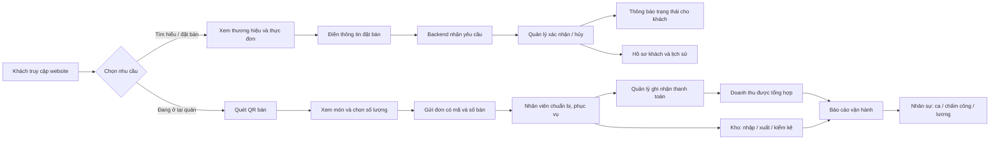
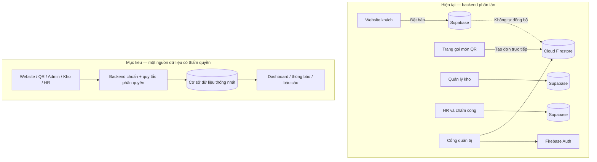
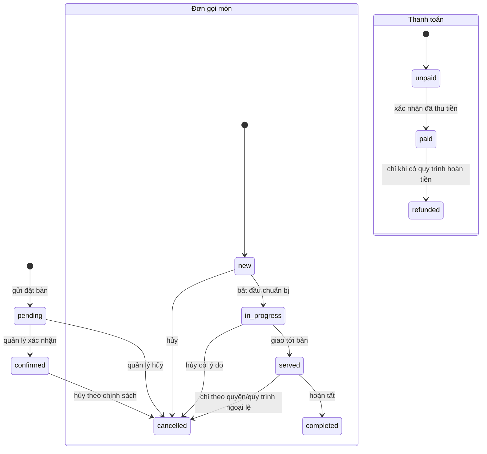
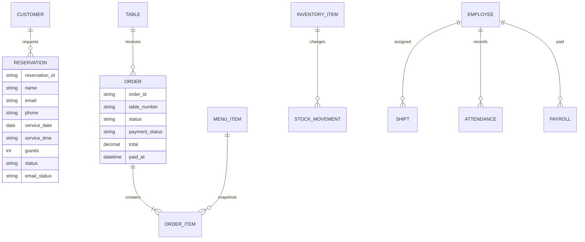
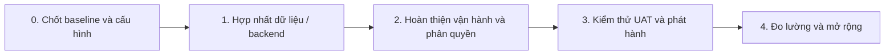

# Tầm nhìn sản phẩm và tài liệu yêu cầu — Mocha & Miso

> **Trạng thái tài liệu:** Baseline sản phẩm và yêu cầu định hướng
> **Ngày cập nhật:** 19-10-2026
> **Phạm vi:** Website khách hàng, đặt bàn, gọi món QR, cổng quản trị, chăm sóc khách hàng, kho và nhân sự
> **Nguyên tắc đọc:** “Hiện trạng” mô tả điều đang có trong mã nguồn; “Mục tiêu/đề xuất” là yêu cầu để hoàn thiện sản phẩm, không khẳng định đã được triển khai.

## 1. Tóm tắt sản phẩm

Mocha & Miso là website thương hiệu kết hợp bộ công cụ vận hành cho một quán cà phê: khách xem không gian và thực đơn, gửi yêu cầu đặt bàn hoặc gọi món bằng QR tại bàn; người quản lý xử lý đặt bàn, đơn, thanh toán, doanh thu, nguyên liệu, hồ sơ nhân viên, lịch làm, chấm công và lương.

Sản phẩm hiện là ứng dụng web tĩnh sử dụng JavaScript phía trình duyệt. Trạng thái backend đang chuyển đổi dở dang: website đặt bàn, kho và nhân sự dùng Supabase; gọi món QR và cổng quản trị đơn/doanh thu dùng Firebase Cloud Firestore. Vì vậy đây **chưa phải một hệ thống vận hành end-to-end có dữ liệu thống nhất**: đặt bàn mới phát sinh trên Supabase chưa tự xuất hiện trong dashboard Firestore. Cần chọn backend chuẩn cho toàn ứng dụng và đối soát dữ liệu trước khi đưa vào vận hành thật.

## 2. Tầm nhìn sản phẩm

### Tuyên bố tầm nhìn

> Giúp khách đặt chỗ và gọi món thuận tiện, đồng thời giúp đội ngũ Mocha & Miso điều hành ca phục vụ, doanh thu, kho và nhân sự trên một quy trình số liền mạch, đáng tin cậy và dễ sử dụng.

### Giá trị đem lại

| Nhóm | Giá trị mong muốn |
|---|---|
| Khách hàng | Dễ tìm hiểu quán, chọn giờ/ngày đặt bàn, nêu yêu cầu, gọi đúng món cho đúng bàn và nhận thông tin rõ ràng khi gửi yêu cầu. |
| Quản lý | Có một nguồn dữ liệu nhất quán để theo dõi đặt bàn, đơn, thanh toán, doanh thu và hoạt động nhân sự; giảm thao tác đối chiếu thủ công. |
| Nhân viên phục vụ/bar/bếp | Nhìn thấy đơn theo bàn, món và ghi chú; chuyển trạng thái phục vụ theo quy trình rõ ràng. |
| Nhân viên kho | Nắm tồn, ngưỡng cảnh báo, nhập/xuất và lịch sử biến động để hạn chế hết hàng và sai lệch. |
| Chủ quán | Có thể đánh giá hoạt động bằng số liệu có nguồn gốc rõ ràng, phân quyền an toàn và quy trình sao lưu/khôi phục. |

### Mục tiêu sản phẩm

1. Tạo trải nghiệm thương hiệu nhất quán, đẹp và dùng tốt trên điện thoại lẫn máy tính.
2. Chuyển yêu cầu đặt bàn thành dữ liệu có thể tiếp nhận, xác nhận, hủy và tra cứu lịch sử khách.
3. Cho phép khách gọi món qua QR với số bàn hợp lệ; giá và nội dung đơn phải được xác nhận ở phía máy chủ.
4. Đưa quản trị đặt bàn, đơn và doanh thu về cùng nguồn dữ liệu với website/QR.
5. Quản lý nguyên liệu qua số dư tồn và nhật ký nhập/xuất có thể đối chiếu.
6. Quản lý hồ sơ nhân viên, phân ca, chấm công, bảng lương và báo cáo trong luồng được phân quyền.
7. Bảo vệ dữ liệu cá nhân, tiền lương và thông tin vận hành; lỗi dịch vụ phải hiển thị minh bạch, không giả báo thành công.

### Chỉ số thành công đề xuất

Các ngưỡng dưới đây là **mục tiêu cần xác nhận với chủ quán**, chưa phải số liệu đo hiện tại.

| Chỉ số | Định nghĩa | Mục tiêu ban đầu |
|---|---|---|
| Tỷ lệ gửi yêu cầu thành công | Yêu cầu đặt bàn/đơn được backend xác nhận ÷ số lần gửi hợp lệ | ≥ 99% khi dịch vụ backend hoạt động |
| Tính nhất quán dashboard | Bản ghi hợp lệ ở nguồn giao dịch xuất hiện trong dashboard chính | 100%, không cần nhập lại thủ công |
| Thời gian phản hồi thao tác | Từ lúc gửi hợp lệ đến lúc có xác nhận trên giao diện | p95 ≤ 3 giây trong điều kiện mạng bình thường |
| Tỷ lệ đơn có số tiền đúng | Đơn được tạo với giá/tổng do máy chủ tính theo menu có hiệu lực | 100% |
| Độ đầy đủ nhật ký kho | Biến động nhập/xuất có bản ghi tham chiếu và số dư khớp | 100% sau mỗi thao tác được xác nhận |
| Khả năng dùng trên di động | Các luồng đặt bàn/gọi món hoàn tất ở viewport di động phổ biến | Không có lỗi chặn luồng ở 360 px trở lên |

## 3. Phạm vi và ranh giới

### Trong phạm vi

- Website công khai: câu chuyện thương hiệu, thực đơn, hình ảnh, thông tin liên hệ và đặt bàn.
- Quản lý đặt bàn: danh sách, trạng thái, tìm kiếm, hồ sơ khách, lịch sử và email thông báo.
- Gọi món theo bàn bằng URL QR, thực đơn/danh mục, giỏ hàng, ghi chú, gửi đơn và mã đơn.
- Quản trị đơn: trạng thái chuẩn bị/phục vụ/hoàn tất, thanh toán và tổng hợp doanh thu.
- Mã QR theo số bàn.
- Kho: danh mục/nguyên liệu, số dư, ngưỡng tối thiểu, nhập, xuất và nhật ký giao dịch.
- Nhân sự: hồ sơ, ca, chấm công, bảng lương và báo cáo CSV.
- Xác thực, phân quyền, bảo vệ dữ liệu và quy trình triển khai/migration.

### Ngoài phạm vi hiện tại (có thể cân nhắc sau)

- Cổng thanh toán trực tuyến, hoàn tiền, đối soát ngân hàng hoặc hóa đơn điện tử.
- Ứng dụng native, giao hàng, quản lý nhiều chi nhánh hoặc chương trình khách hàng thân thiết.
- Khấu trừ nguyên liệu tự động theo công thức/định lượng món; hiện chưa có mô hình công thức nguyên liệu.
- Đồng bộ thiết bị POS/phần cứng, máy in bếp, SMS/Zalo hoặc hệ thống kế toán bên ngoài.
- Tự động tối ưu ca, định biên nhân sự hoặc tính lương theo luật/lao động đã được chuyên gia xác nhận.

## 4. Người dùng và quyền hạn

| Vai trò | Nhu cầu chính | Quyền mục tiêu |
|---|---|---|
| Khách chưa đăng nhập | Xem quán/thực đơn; gửi đặt bàn; gọi món tại bàn | Chỉ tạo dữ liệu hợp lệ qua luồng công khai; không đọc danh sách khách, đơn, kho hoặc HR |
| Quản lý/chủ quán | Điều phối vận hành và xem báo cáo | Đọc/ghi các phân hệ theo quyền quản trị; duyệt đặt bàn, đơn và thanh toán |
| Nhân viên phục vụ/bar/bếp | Nhận và cập nhật tiến độ đơn | Chỉ xem đơn cần xử lý và cập nhật trạng thái được giao; quyền chi tiết là mục tiêu cần thiết kế |
| Nhân viên kho | Theo dõi nguyên liệu, ghi nhập/xuất | Chỉ truy cập kho và nhật ký kho theo quyền được cấp |
| Quản lý nhân sự | Quản lý hồ sơ, ca, công và lương | Truy cập dữ liệu nhân sự; lương chỉ dành cho vai trò được ủy quyền |

**Hiện trạng quyền:** cổng quản trị Firebase giới hạn tài khoản theo email cấu hình trong mã nguồn; Firestore Rules phải đồng thời bảo vệ dữ liệu. HR/kho dùng Supabase Auth và RLS với vai trò `admin`. Chưa có phân quyền chi tiết theo vai trò nhân viên/kho; cần hoàn thiện trước vận hành nhiều người dùng.

## 5. Bức tranh luồng sản phẩm

### Hành trình tổng thể

### Kiến trúc hiện tại và trạng thái cần đạt

**Lựa chọn backend là quyết định kiến trúc bắt buộc:** hoặc hoàn tất chuyển các luồng còn lại về Firebase, hoặc chuyển cổng quản trị sang Supabase sau khi xác nhận tài khoản và cấu hình, hoặc xây cơ chế đồng bộ có giám sát. Không coi việc ghi song song hai backend là giải pháp mặc định vì có thể gây bản ghi trùng/lệch và khó xác định dữ liệu chuẩn.

## 6. Yêu cầu chức năng

**Quy ước ưu tiên:** P0 = cần cho luồng vận hành đáng tin cậy; P1 = cần cho vận hành đầy đủ; P2 = cải tiến sau. Các yêu cầu gắn nhãn “Mục tiêu” chưa được đảm bảo đã có trong code.

### 6.1 Website công khai và thực đơn

| ID | Ưu tiên | Yêu cầu |
|---|---|---|
| WEB-01 | P1 | Hiển thị câu chuyện, hình ảnh, món đặc sắc, đánh giá, địa chỉ, giờ mở cửa và kênh liên hệ của quán. |
| WEB-02 | P1 | Điều hướng một trang, menu trên di động và liên kết tới đặt bàn, QR, cổng quản trị. |
| WEB-03 | P0 | Thực đơn hiển thị tên, mô tả, ảnh, danh mục, giá; giá dùng VND và phải đồng nhất với giá tạo đơn. |
| WEB-04 | P1 | Mục hết món/ngừng bán không được khách thêm vào giỏ hoặc gửi thành đơn. |
| WEB-05 | P1 | Nội dung và liên hệ phải cấu hình được; dữ liệu demo/địa chỉ mẫu không được nhầm là thông tin vận hành thật. |

**Hiện trạng:** trang marketing có nội dung thương hiệu và danh mục; trang QR dùng danh sách món tĩnh trong `js/order.js`. SQL Supabase cũng có `menu_items`, nhưng đây không phải nguồn cho QR hiện tại. Yêu cầu P0 là thống nhất menu/giá giữa màn hình khách và nguồn xác thực tại server.

### 6.2 Đặt bàn

| ID | Ưu tiên | Yêu cầu |
|---|---|---|
| RSV-01 | P0 | Cho nhập tên, email, ngày, giờ; điện thoại và yêu cầu đặc biệt tùy chọn; chọn 1–12 khách trên giao diện hiện tại. |
| RSV-02 | P0 | Từ chối dữ liệu bắt buộc thiếu/sai; không cho đặt ngày quá khứ; khóa nút gửi trong lúc xử lý để hạn chế gửi lặp. |
| RSV-03 | P0 | Chỉ hiện “đã nhận yêu cầu” khi backend xác nhận ghi thành công. Nếu backend lỗi, thông báo rõ chưa gửi tới quán; dữ liệu localStorage không được mô tả là đã nhận từ xa. |
| RSV-04 | P1 | Tạo mã tham chiếu đặt bàn duy nhất, trạng thái ban đầu `pending`, dấu thời gian tạo/cập nhật. |
| RSV-05 | P0 | Quản lý có thể lọc theo trạng thái, tìm theo tên/email/điện thoại, xem chi tiết, xác nhận, hủy và xóa theo quyền. |
| RSV-06 | P1 | Gửi email nhận yêu cầu/xác nhận/hủy tùy cấu hình; ghi trạng thái `Pending`/`Sent`/`Failed`; lỗi email không làm mất đặt bàn. |
| RSV-07 | P1 | Hồ sơ khách nhóm theo email chuẩn hóa; nếu không có email dùng số điện thoại; nếu thiếu cả hai thì giữ lịch sử riêng. |
| RSV-08 | P1 | Trước khi xác nhận, quản lý nhìn rõ ngày, giờ, số khách, ghi chú và trạng thái email. |
| RSV-09 | P2 | Mục tiêu: giới hạn sức chứa theo khung giờ và cảnh báo trùng/không khả dụng; cần quy tắc sức chứa và sơ đồ bàn từ nghiệp vụ. |

### 6.3 Gọi món QR và xử lý đơn

| ID | Ưu tiên | Yêu cầu |
|---|---|---|
| ORD-01 | P0 | QR mang mã bàn chuẩn `01`–`99`; URL thiếu/sai bàn hiển thị trang lỗi, không cho gửi đơn. |
| ORD-02 | P0 | Khách lọc danh mục, xem món/giá, thêm/bớt số lượng, ghi chú cho bar/bếp và xem tạm tính. |
| ORD-03 | P0 | Đơn phải có ít nhất một món; số lượng mỗi món và tổng số lượng phải nằm trong giới hạn máy chủ. |
| ORD-04 | P0 | Gửi mã món + số lượng + bàn + ghi chú; backend tra tên/giá từ menu có hiệu lực và tự tính tổng, không tin giá/tổng do trình duyệt gửi. |
| ORD-05 | P0 | Chỉ báo thành công và hiển thị mã đơn sau khi backend xác nhận tạo đơn; nếu lỗi giữ giỏ để thử lại và giải thích nguyên nhân. |
| ORD-06 | P1 | Nhân viên xem hàng đợi đơn có mã, bàn, món, số lượng, ghi chú, tổng và trạng thái. |
| ORD-07 | P1 | Vòng đời mục tiêu: `new` → `in_progress` → `served` → `completed`; `cancelled` là nhánh hủy có lý do/audit. |
| ORD-08 | P0 | Thanh toán độc lập với trạng thái món; chỉ đơn `paid` được tính doanh thu; lưu thời điểm thanh toán. |
| ORD-09 | P1 | Chống tạo đơn trùng khi khách nhấn gửi nhiều lần hoặc retry sau timeout; thao tác phải có idempotency key phía server. |
| ORD-10 | P1 | Mục tiêu: cập nhật trạng thái gần thời gian thực và có thông báo cho nhân viên; hiện giao diện gọi món chỉ xác nhận đã gửi, chưa có theo dõi trạng thái cho khách. |

**Hiện trạng cần lưu ý:** `js/order.js` ghi trực tiếp document vào Firestore collection `orders`, gồm tên món, giá và tổng do trình duyệt tạo; `admin.js` nghe cùng collection. Vì vậy order QR không phụ thuộc Supabase, nhưng giá/tổng hiện chưa được tái xác minh bởi server tin cậy và Firestore Rules phải chặn khách đọc đơn hoặc sửa trạng thái/thanh toán. ORD-04/ORD-09 là tiêu chí mục tiêu cần hoàn thiện bằng Cloud Function/endpoint, Rules phù hợp và cơ chế chống gửi trùng trước khi coi luồng an toàn cho production.

### 6.4 Quản trị, doanh thu và chăm sóc khách

| ID | Ưu tiên | Yêu cầu |
|---|---|---|
| ADM-01 | P0 | Chỉ tài khoản được phép mới xem dashboard; hỗ trợ đăng nhập, đăng xuất và quy trình đặt lại mật khẩu. |
| ADM-02 | P0 | Dashboard hiển thị số đặt bàn, chờ xác nhận, đã xác nhận, tổng khách và danh sách giao dịch phù hợp. |
| ADM-03 | P0 | Đơn và đặt bàn phải lấy từ cùng backend có thẩm quyền với website/QR; có trạng thái tải, rỗng và lỗi rõ ràng. |
| ADM-04 | P0 | Đổi trạng thái phải xác nhận lưu thành công; nếu thất bại rollback UI hoặc tải lại dữ liệu, không hiển thị thành công giả. |
| REV-01 | P0 | Doanh thu chỉ bao gồm đơn đã thanh toán, loại đơn hủy/chưa thanh toán. |
| REV-02 | P0 | Doanh thu ngày/tháng dựa trên `paid_at`/`paidAt`, dùng một timezone nghiệp vụ được thống nhất; tổng toàn thời gian cộng đơn paid hợp lệ. |
| REV-03 | P1 | Bảng doanh thu phải cho phép truy ngược mã đơn, bàn, thời điểm thanh toán và tổng tiền. |
| CUS-01 | P1 | Danh bạ khách hiển thị thông tin nhận diện tối thiểu, số lượt, lần đặt gần nhất và lịch sử; dữ liệu đầu ra phải escape để tránh XSS. |
| CUS-02 | P1 | Xóa/ẩn dữ liệu khách phải theo chính sách lưu trữ và quyền; cân nhắc không xóa lịch sử giao dịch cần đối soát. |

### 6.5 Kho

| ID | Ưu tiên | Yêu cầu |
|---|---|---|
| INV-01 | P0 | Tạo/sửa/xóa nguyên liệu gồm tên, danh mục, số lượng, đơn vị, mức tồn tối thiểu và giá nhập. |
| INV-02 | P0 | Hiển thị tổng nguyên liệu, sắp hết và hết hàng; ngưỡng sắp hết là số lượng dương nhưng ≤ mức tối thiểu. |
| INV-03 | P0 | Nhập kho yêu cầu nguyên liệu, lượng dương, giá VND không âm/nguyên, nhà cung cấp; cập nhật số dư và lưu nhật ký. |
| INV-04 | P0 | Xuất kho yêu cầu nguyên liệu, lượng dương, lý do (sản xuất hoặc hỏng/hết hạn), ghi chú tùy chọn; không cho số dư âm. |
| INV-05 | P1 | Lịch sử nhập/xuất hiển thị thời gian, mặt hàng, lượng, nhà cung cấp/lý do và ghi chú. |
| INV-06 | P1 | Thay đổi số lượng chỉ qua giao dịch nhập/xuất/kiểm kê có audit; không chỉnh trực tiếp số lượng trong modal sửa. |
| INV-07 | P1 | Mỗi giao dịch cập nhật tồn và ghi nhật ký trong một transaction nguyên tử; nếu một bước lỗi thì không để số liệu lệch. |
| INV-08 | P2 | Mục tiêu: báo cáo giá trị tồn và kiểm kê chênh lệch; cần chốt phương pháp định giá, quyền điều chỉnh và lưu lý do. |

### 6.6 Nhân sự

| ID | Ưu tiên | Yêu cầu |
|---|---|---|
| HR-01 | P0 | Tạo/sửa hồ sơ: mã, họ tên, ngày sinh, giới tính, email, điện thoại, địa chỉ, chức vụ, trạng thái làm việc. |
| HR-02 | P1 | Tìm kiếm nhân viên theo mã, tên, liên hệ, chức vụ; nhân viên nghỉ không xuất hiện ở danh sách chọn ca mới. |
| HR-03 | P0 | Xếp ca ngày/nhân viên: sáng, chiều, tối; không tạo trùng nhân viên/ngày/ca; có thể đổi ca. |
| HR-04 | P0 | Ghi giờ vào/ra hợp lệ; tính giờ qua nửa đêm; trạng thái đi trễ theo lịch ca (hiện ngưỡng 10 phút trong logic). |
| HR-05 | P1 | Hiển thị ngày công, giờ làm, đi trễ, vắng và chấm công còn thiếu so với ca đã qua. |
| HR-06 | P0 | Lập bảng lương tháng theo giờ hoặc tháng; tính lương thường + tăng ca (hiện hệ số 1.5) + thưởng − phạt, không âm; lưu tháng/nhân viên duy nhất. |
| HR-07 | P1 | Báo cáo ngày/tháng và xuất CSV có tổng nhân viên, giờ làm, tổng lương, đi trễ/vắng. |
| HR-08 | P0 | Dữ liệu HR và lương chỉ hiển thị với tài khoản được cấp quyền; không lưu bản sao lương nhạy cảm không mã hóa trong localStorage. |
| HR-09 | P1 | Mất mạng hoặc lỗi backend phải báo trạng thái rõ; chế độ local hiện có chỉ nên dùng như hàng đợi có kiểm soát, có đồng bộ/xung đột và cảnh báo không đồng bộ. |

### 6.7 Mã QR, cấu hình và liên lạc

- **QR-01 (P1):** Sinh mã QR cho mỗi bàn hợp lệ, trỏ tới trang gọi món với `?table=NN`; tải/in được và có nhãn số bàn rõ.
- **CFG-01 (P1):** Cấu hình Firebase/Supabase/EmailJS tách khỏi logic; không commit khóa bí mật. Khóa client public chỉ an toàn khi backend policy đúng.
- **COM-01 (P1):** Email gửi không đồng nghĩa với lưu giao dịch; lỗi email phải được theo dõi độc lập và có thể thử lại có giới hạn.
- **AUD-01 (P1):** Ghi người thực hiện, thời gian, giá trị trước/sau cho đổi trạng thái, thanh toán, điều chỉnh kho, hồ sơ và bảng lương (mục tiêu cần bổ sung).

## 7. Quy tắc nghiệp vụ và dữ liệu

### Trạng thái mục tiêu

`refunded` là trạng thái mục tiêu tương lai, chưa có trong schema hiện tại. Không tự suy diễn rằng đơn `completed` đã thanh toán; hai trạng thái phục vụ và thanh toán cần tách biệt.

### Thực thể cốt lõi

Biểu đồ thể hiện mô hình nghiệp vụ mục tiêu; bảng/collection thực tế hiện có thể khác. Đơn cần lưu snapshot tên/giá món tại thời điểm đặt để lịch sử không đổi khi menu được cập nhật. Thực thể `CUSTOMER`, `TABLE`, `ORDER_ITEM`, `STOCK_MOVEMENT` là mô hình khái niệm; schema hiện tại lưu một số thông tin khách trực tiếp ở `reservations`, `items` dạng JSONB trong `orders`, và giao dịch kho ở hai bảng nhập/xuất.

### Quy tắc dữ liệu quan trọng

- Ngày/giờ phục vụ là giờ địa phương của quán; dấu thời gian hệ thống lưu UTC và báo cáo quy đổi về timezone nghiệp vụ đã chốt.
- Tiền lưu số nguyên VND hoặc kiểu decimal chính xác; không sử dụng số dấu phẩy động làm nguồn tính tiền authoritative.
- Đơn QR nhận danh sách ID món và số lượng. Máy chủ xác thực bàn, giới hạn số lượng, trạng thái còn bán, tên/giá và tổng tiền.
- ID gốc Firestore được bảo toàn trong `source_firebase_id` khi migration; chạy lại migration phải upsert idempotent.
- Email và điện thoại là dữ liệu cá nhân; chỉ thu thập đúng nhu cầu, hạn chế hiển thị/xuất file và có thời hạn lưu trữ.
- Thao tác xóa có thể ảnh hưởng lịch sử; ưu tiên lưu vết/ẩn mềm với dữ liệu đã phát sinh thanh toán hoặc giao dịch.

## 8. Yêu cầu phi chức năng

| Mã | Lĩnh vực | Tiêu chí cần nghiệm thu |
|---|---|---|
| NFR-SEC-01 | Xác thực/phân quyền | Quyền được kiểm tra ở backend (RLS/Firestore Rules), không chỉ ẩn nút ở UI; tài khoản khách không đọc dữ liệu vận hành. |
| NFR-SEC-02 | Bí mật | Không có service-role key, service-account, token hoặc private key trong client, repository hay log. |
| NFR-SEC-03 | XSS/đầu vào | Mọi nội dung khách/nhân viên render phải escape; backend validate lại mọi trường và giới hạn độ dài/giá trị. |
| NFR-PRIV-01 | Riêng tư | HR/lương/đặt bàn được hạn chế đúng vai trò; CSV không để lộ dữ liệu ngoài phạm vi báo cáo. |
| NFR-REL-01 | Tính đúng | Giao dịch cập nhật tồn, thanh toán và tạo đơn phải nguyên tử/idempotent nơi phù hợp; lỗi không tạo trạng thái thành công giả. |
| NFR-REL-02 | Sao lưu | Có lịch backup, thời hạn lưu, quy trình restore thử nghiệm và checklist trước migration. |
| NFR-PERF-01 | Hiệu năng | Mục tiêu p95 ≤ 3 giây cho thao tác nghiệp vụ thông thường; danh sách lớn phải lọc/phân trang phía server. |
| NFR-UX-01 | Thiết bị | Luồng khách hoạt động từ viewport 360 px; bảng quản trị dùng được trên điện thoại hoặc có phương án cuộn/thu gọn dễ hiểu. |
| NFR-A11Y-01 | Trợ năng | Điều khiển bàn phím, focus rõ, nhãn form, lỗi gắn với trường, trạng thái dùng được với screen reader; chuyển động tôn trọng reduced motion. |
| NFR-OBS-01 | Vận hành | Log lỗi có mã luồng và ngữ cảnh không nhạy cảm; thông báo người dùng có hướng xử lý, không lộ stack/credential. |
| NFR-COMPAT-01 | Trình duyệt | Hỗ trợ các bản mới gần đây của Chrome, Edge, Safari và Firefox trên desktop/di động. |
| NFR-LOC-01 | Bản địa hóa | Giao diện tiếng Việt, tiền VND, ngày/giờ và timezone thống nhất; nội dung địa chỉ/liên hệ cấu hình đúng thực tế. |

## 9. Tiêu chí nghiệm thu theo hành trình

### Đặt bàn

1. Khi thiếu tên/email/ngày/giờ hoặc chọn ngày quá khứ, không ghi backend; người dùng thấy lỗi cụ thể.
2. Khi backend thành công, tạo một yêu cầu `pending` với mã tham chiếu; giao diện hiển thị xác nhận.
3. Khi backend lỗi/mất mạng, giao diện không nói yêu cầu đã đến quán; người dùng có thể thử lại mà không mất thông tin đã nhập.
4. Quản lý xác nhận/hủy; trạng thái mới xuất hiện sau khi lưu thành công; email thất bại không làm đổi trạng thái ghi nhận thành công thành thất bại.

### Gọi món và doanh thu

1. QR bàn sai/ngoài phạm vi không thể tạo đơn.
2. Tạm tính giao diện có thể tham khảo nhưng tổng lưu cuối cùng phải do backend tính từ menu hiện hành.
3. Món ngừng bán, ID giả, số lượng ngoài giới hạn và payload sai bị từ chối an toàn.
4. Đơn gửi thành công có mã, số bàn, item snapshot, tổng chính xác và trạng thái `new`/`unpaid`.
5. Chỉ thao tác thanh toán được quyền mới chuyển payment sang `paid` và ghi `paid_at`.
6. Đơn unpaid/hủy không cộng doanh thu; đơn paid cộng đúng một lần và đúng ngày/tháng timezone quán.

### Kho và nhân sự

1. Không thể nhập/xuất số lượng bằng 0/âm; xuất vượt tồn phải bị từ chối.
2. Nếu cập nhật số dư hoặc ghi nhật ký thất bại, toàn bộ giao dịch không được commit một nửa.
3. Ca trùng bị database từ chối; đi trễ được tính theo ca và ngưỡng đã công bố.
4. Chấm công qua nửa đêm tính đúng số phút; giờ vào/ra sai định dạng bị từ chối.
5. Công thức bảng lương hiển thị thành phần và làm tròn theo chính sách được xác nhận; lưu tháng không tạo bản ghi trùng.
6. Tài khoản không có role không đọc/ghi hồ sơ, bảng công hoặc lương kể cả khi gọi trực tiếp API.

## 10. Rủi ro, phụ thuộc và quyết định cần chốt

| Vấn đề | Tác động | Hướng xử lý |
|---|---|---|
| Firebase/Supabase đang chia luồng | Đặt bàn/đơn bị phân mảnh; doanh thu dashboard thiếu giao dịch mới | Chọn backend chuẩn; sau đó chuyển luồng và đối soát trước khi tắt nguồn cũ |
| Cấu hình Supabase anon key/schema chưa được xác nhận live | Website đặt bàn, kho hoặc HR có thể báo lỗi/mất tính năng | Thiết lập môi trường staging, kiểm tra schema/RLS bằng tài khoản anon và admin |
| QR ghi trực tiếp giá/tổng từ trình duyệt vào Firestore | Payload giả mạo có thể làm sai giá trị đơn nếu Firestore Rules chỉ kiểm tra quyền ghi | Chuyển việc tra menu/tính tổng/giới hạn số lượng sang backend tin cậy; kiểm thử Rules bằng tài khoản khách |
| Menu QR hiện tĩnh, backend dùng `menu_items` | Món/giá hiển thị có thể khác giá server hoặc món không tồn tại | Dùng menu đọc từ nguồn backend; giữ server là nguồn giá cuối |
| EmailJS chạy từ client | Email có thể lỗi/được gửi trùng; không nên là điều kiện giao dịch | Tách trạng thái email khỏi đặt bàn; cân nhắc worker/backend và idempotency |
| LocalStorage fallback của hồ sơ nhân viên | Dữ liệu có thể chỉ nằm trên một trình duyệt hoặc xung đột khi đồng bộ | Hiển thị chế độ offline rõ ràng; có queue, version/conflict policy, không dùng cho dữ liệu nhạy cảm |
| Tồn kho cập nhật và nhật ký ghi tách bước | Có thể lệch số dư nếu bước thứ hai lỗi | Gộp vào transaction/RPC phía server và thêm kiểm thử lỗi giữa chừng |
| Địa chỉ, điện thoại, giờ mở cửa mẫu khác nhau trong nội dung | Khách nhận thông tin sai | Chốt thông tin vận hành thật và đưa vào cấu hình nội dung thống nhất |
| Tính tiền/giờ công/lương | Sai số gây tranh chấp hoặc sai báo cáo | Chốt quy tắc làm tròn, timezone, ca qua đêm, tăng ca, khấu trừ với chủ quán trước phát hành |
| Migration Firestore → Supabase chưa chạy | Dữ liệu cũ chưa được nhập/đối soát | Backup, dry-run, mapping, kiểm tra số lượng, nhập có thể chạy lại, UAT rồi mới cutover |

### Quyết định cần chủ sản phẩm xác nhận

1. Backend chuẩn cuối cùng cho toàn ứng dụng là Firebase hay Supabase?
2. Có giữ một tài khoản admin duy nhất hay cần vai trò quản lý/phục vụ/kho/HR riêng?
3. Sức chứa đặt bàn, chính sách xác nhận/hủy/no-show và giờ nhận khách thực tế?
4. Quy tắc thanh toán: ai được đánh dấu đã thu tiền, xử lý nhầm trạng thái/hoàn tiền thế nào?
5. Danh sách món, giá, trạng thái còn bán nào là dữ liệu thật; menu có cần sửa từ dashboard?
6. Đơn xuất kho “dùng pha chế” có trừ theo công thức món hay nhân viên ghi lượng thực tế?
7. Chính sách lưu/xóa dữ liệu khách, hồ sơ nhân viên, chấm công, bảng lương và email?
8. Quy tắc tính lương, làm tròn, hệ số tăng ca, thưởng/phạt và phê duyệt bảng lương?
9. Địa chỉ, số điện thoại, email, giờ hoạt động và timezone chính thức của quán?

## 11. Lộ trình đề xuất

### Giai đoạn 0 — Chốt baseline và cấu hình (P0)

- Xác nhận thông tin quán, backend mục tiêu, môi trường development/staging/production.
- Kiểm tra Firebase Auth, Firestore Rules cho đặt đơn khách, Supabase URL/anon key, schema/RLS và EmailJS.
- Chụp số lượng/bản sao lưu nguồn trước mọi thay đổi; lập danh sách dữ liệu demo và thật.
- Kết quả: quyết định kiến trúc được ghi nhận; checklist cấu hình không chứa bí mật.

### Giai đoạn 1 — Hợp nhất dữ liệu/backend (P0)

- Chuẩn hóa schema/menu/trạng thái; chuyển luồng đặt bàn, QR, dashboard về cùng backend.
- Chạy migration Firestore→Supabase chỉ sau backup, dry-run và xác nhận quyền; nhập các collection `reservations`/`orders` cần thiết sau khi chốt backend mục tiêu, đối soát ID nguồn/số tiền/số lượng.
- Kiểm thử RLS/Firestore Rules, chống đơn trùng, timestamp/timezone, thanh toán và doanh thu.
- Kết quả: không còn hai bản dữ liệu cần nhập thủ công; dashboard có thể đối chiếu tới nguồn giao dịch.

### Giai đoạn 2 — Hoàn thiện vận hành và phân quyền (P1)

- Hợp nhất vai trò; giới hạn HR/lương/kho theo trách nhiệm.
- Làm transaction cho nhập/xuất kho; audit cho thanh toán, trạng thái và điều chỉnh.
- Tải menu QR từ backend; theo dõi đơn và tình trạng gửi email.
- Làm rõ xử lý offline và xung đột; bổ sung sao lưu/khôi phục thử nghiệm.

### Giai đoạn 3 — UAT và phát hành (P0)

- Chạy kịch bản khách, quản lý, nhân viên, kho, HR trên staging với dữ liệu giả đã đánh dấu.
- Kiểm tra di động, trợ năng, RLS, lỗi mạng, retry, timezone và báo cáo.
- Chủ quán/người đại diện ký nghiệm thu; hướng dẫn thao tác, rollback và hỗ trợ sự cố.
- Chỉ chuyển traffic khi không còn lỗi P0 và dữ liệu đã được đối soát.

### Giai đoạn 4 — Đo lường và mở rộng (P2)

- Thu thập chỉ số funnel đặt bàn, thời gian xử lý đơn, sai lệch tồn, lỗi đồng bộ và hiệu năng.
- Xem xét dashboard phân tích, cảnh báo tồn, theo dõi trạng thái cho khách và multi-role.
- Chỉ triển khai thanh toán online, loyalty, recipe deduction hoặc đa chi nhánh khi có yêu cầu nghiệp vụ đã xác nhận.

## 12. Kiểm thử và tài liệu tham chiếu

### Nhóm kiểm thử tối thiểu trước phát hành

- Unit: mapping trạng thái, tổng tiền, tiền tệ, ngày thanh toán, giờ công/lương.
- Integration: RPC tạo đơn, RLS, cập nhật trạng thái, thanh toán, transaction kho và migration.
- Security: truy cập ẩn danh tới dữ liệu khách/đơn/HR; role không đủ quyền; payload XSS/SQL/payload vượt giới hạn.
- E2E/UAT: đặt bàn → xác nhận/email; QR → đơn → phục vụ → thanh toán → doanh thu; nhập/xuất kho; hồ sơ → ca → chấm công → lương → CSV.
- Resilience: offline, timeout, retry, submit kép, EmailJS lỗi, backend từ chối và khôi phục phiên đăng nhập.

Trong repository có các test Node cho `admin-auth`, `customer-care`, `table-orders`, `revenue`, `hr-auth` và `firebase-migration`. Test mocked không thay thế kiểm thử live với Firebase/Supabase và không xác nhận cấu hình production.

### Tham chiếu trong repository

- [README](../README.md) — tính năng, chạy local và cấu hình hiện tại.
- [Kiến trúc](./architecture.md) — phân chia backend và luồng dữ liệu.
- [Cổng quản trị](../admin.html) và [logic dashboard](../admin.js).
- [Website khách](../index.html), [xử lý đặt bàn](../js/main.js), [gọi món QR](../order.html), [logic gọi món](../js/order.js).
- [Quản lý kho](../inventory.html), [logic kho](../js/inventory.js).
- [Quản lý nhân sự](../hr.html), [hồ sơ nhân viên](../employee-management.js), [ca/chấm công/lương](../staff-operations.js).
- [Schema Supabase](../database/supabase-schema.sql), [migration RLS/RPC](../database/firebase-to-supabase.sql), [schema HR](../employee-hr.sql).

---

**Ghi chú quản trị tài liệu:** Cập nhật mục “Hiện trạng” sau mỗi lần đổi backend hoặc luồng dữ liệu; cập nhật yêu cầu/tiêu chí khi chủ quán chốt chính sách. Mọi chỉ số mục tiêu cần có nguồn đo, người phụ trách và khoảng thời gian đánh giá trước khi dùng làm cam kết vận hành.
